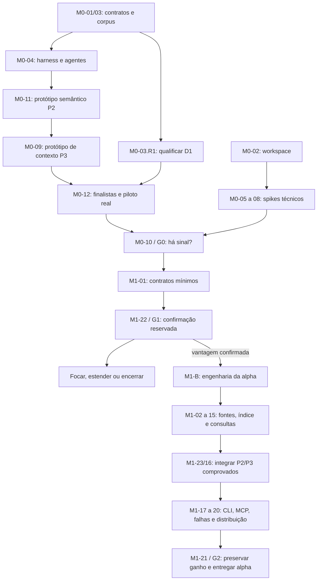

# Plano de implementação — M0 e M1

Data: 11/10/2026. **Revisão L1: decisões arquiteturais C01/S01/S02 resolvidas; próximo lote L2 preparado.** Corpus inicial aceito no escopo de desenvolvimento; M0-03.R1 qualifica o D1 antes do piloto. M0-04/05/08 podem começar. [Parecer, evidências e sequência](relatorios/REVISAO-L1.md). V1 continua Linux x86_64/macOS arm64; CI nativa permanece pendente conforme o [estado](STATUS-IMPLEMENTACAO.md).

Base: [RFC-0001](RFC-0001-ARQUITETURA.md), [plano de validação](PLANO-DE-VALIDACAO.md), [protocolo de diferenciação](PROVA-DE-DIFERENCIACAO.md) e [estudo comparativo](ESTUDO-COMPARATIVO.md). Este documento detalha entregáveis e critérios da arquitetura. A existência e a verificação de cada entregável são registradas no estado de implementação; mencionar um caminho ou comando neste plano não comprova sua implementação.

Entrada operacional da outra IA: [IMPLEMENTADOR.md](../IMPLEMENTADOR.md). O usuário definiu que o arquiteto planeja e a IA implementadora escreve código e executa as atividades. **Qualidade é o objetivo primário; economia isolada não aprova o projeto.** Estado de execução: [STATUS-IMPLEMENTACAO.md](STATUS-IMPLEMENTACAO.md).

## 1. Resultado esperado e fronteiras

**M0 termina com uma decisão G0 sobre a tese:** protótipos delimitados de semântica de M2 e seleção de contexto de M3 enfrentam concorrentes fortes em tarefas reais. O sinal de vantagem e os spikes de autonomia, workers, snapshots e armazenamento liberam somente a confirmação de M1-A.

**M1-A termina com uma decisão G1 de investimento**, usando dados reservados, agentes reais, ablations e custo completo. A engenharia ampla da alpha depende dessa decisão. Se a vantagem não se sustentar, focar, simplificar ou encerrar a tese sem completar infraestrutura por inércia.

**M1-B termina com uma alpha utilizável e decisão G2:** o fluxo `index → search → inspect → context → expand`, CLI/MCP, atualização e distribuição preservam os ganhos demonstrados. A navegação atende as quatro famílias; a semântica e o contexto avançado declaram exatamente os recortes comprovados.

| Capacidade | Compromisso em M0/M1 | Continuação |
|---|---|---|
| Linguagens | Rust, TS/JS, Python e Go; extração sintática e protótipos de resolução em recortes explícitos | Ampliar módulos, nomes, tipos e chamadas em M2 somente conforme ganho |
| Relações | Contenção/definição e bindings/alvos demonstráveis nos recortes P2; candidatos e lacunas preservados | Semântica ampla e impacto em M2/M3 |
| Fonte | Bytes preservados, hash e spans; outlines e leitura por símbolo/arquivo | Slicing em M5 |
| Contexto | P3 testa obrigações, base/head, orçamento e expansão com agente real | Propósito, seleção de testes e maior cobertura de tarefas em M3 |
| Atualização | Reconciliação explícita e na consulta; reextração dos arquivos afetados | Watcher como otimização posterior, sem mudar a correção |
| Worktrees | Estado próprio por checkout e ausência de mistura entre eles | Hidratação e reuso entre bancos em M5 |
| Integração | CLI e seis ferramentas MCP com capacidades limitadas ao que existe | Integrações adicionais conforme evidência de uso |
| Distribuição | Linux x86_64 e macOS arm64: autonomia em M0 e os mesmos dois alvos na alpha/v1 após G1 | Windows e outras arquiteturas somente após v1 e nova decisão de escopo |
| Avaliação | Triagem dos oito concorrentes, piloto D1 e confirmação H1 em M1-A | M3 amplia a validade para novos domínios; não recebe a primeira prova |

Uma consulta de callers sem resolver disponível retorna `unsupported_capability` e orientação de busca; não retorna vazio com aparência de completude. Correção e revisão por diff entram cedo no **harness experimental**, com P2/P3 e snapshots capturados. Só recortes aprovados são promovidos à alpha. Seleção que autoriza omitir testes, ingestão de SCIP/LSP pelo produto, embeddings, propósito curado, memória e recibos continuam posteriores. Índices externos podem servir como oracle do avaliador e como regime declarado dos concorrentes.

Não estabelecer prazo de calendário sem equipe e resultados dos spikes. As tarefas indicam dependências técnicas e evidência de conclusão. Quem executar poderá estimar as próximas entregas após M0, a partir do trabalho observado.

### Matriz de plataformas do v1

| Alvo obrigatório de M0 até a alpha/v1 | Target Rust inicial | Prova exigida |
|---|---|---|
| Linux x86_64 | `x86_64-unknown-linux-gnu` | Ubuntu 24.04 LTS/glibc 2.39 como baseline inicial; ABI e autonomia verificadas em M0-05/M1-20 |
| macOS arm64 (Apple Silicon) | `aarch64-apple-darwin` | Piso macOS 15.0 e deployment target explícito; execução nativa no piso em M0-05/M1-20 |

Windows, Linux arm64 e macOS Intel estão fora do aceite e da distribuição do v1. Musl não é um terceiro artefato obrigatório. Remover Windows da CI obrigatória é trabalho de M0-02.R2; resultados históricos são preservados. O aceite técnico passa a exigir ambos os alvos acima, com os mesmos critérios de correção, autonomia, recuperação e qualidade. CRLF, Unicode, paths nativos sem perda e case sensitivity continuam relevantes nos dois sistemas. Reparse points, processos/locking e instalação específicos do Windows ficam para depois do v1; formatos documentais já existentes podem ser preservados como extensão futura, sem anunciar suporte.

## 2. Regras de execução e conclusão

- IDs existentes são preservados: **35 tarefas principais e quatro atividades complementares**, `M0-01.R1`, `M0-02.R1`, `M0-02.R2` e `M0-03.R1`, com execução individual em [STATUS-IMPLEMENTACAO.md](STATUS-IMPLEMENTACAO.md). A ordem de execução segue dependências, não numeração. M0-10 continua a saída de M0; M1-22 ocorre antes da engenharia ampla de M1.
- “Depende de” significa que o contrato/entregável anterior está disponível e passou nos critérios pertinentes. Preparar fixtures e especificações em paralelo é permitido; não declarar um marco concluído antecipadamente.
- Cada tarefa deve produzir uma mudança revisável, seus testes relevantes e evidências dos critérios de aceite. Uma tarefa grande pode virar subtarefas com sufixo, preservando o ID e o aceite do conjunto.
- Não criar testes que apenas reproduzem a implementação. Priorizar oracles independentes, fixtures rotuladas, comparação incremental/rebuild e falhas injetadas nas fronteiras reais.
- Resultados medidos ficam em relatórios com commit, configuração, plataforma, hardware, comandos e saídas. Metas propostas não contam como resultados.
- Decisões seguem os ADRs 001–022 da RFC, incluindo [admissão do corpus](decisoes/CORPUS-QUALIFICADO.md) e [persistência/retenção](decisoes/PERSISTENCIA-E-RETENCAO.md). Mudança de contrato, persistência, isolamento, regime de comparação ou dependência runtime deve atualizar o ADR pertinente e os critérios afetados.
- Spikes de M0 podem ser descartados. Sua promoção para M1 exige limites, tratamento de falhas e testes de produção; um experimento que funcionou uma vez não cumpre esses requisitos.
- Qualidade já está fixada como rota primária. Antes da campanha, congelar limites de esforço/uso de modelos, critérios de custo proporcional, amostra, comparadores e análise. M0 permite duas versões por hipótese; M1-A, uma campanha reservada e uma adicional. Inconclusivo não libera M1-B automaticamente.

Definição comum de concluído: aceite demonstrado; diagnóstico útil para falhas; comportamento documentado; sem escopo oculto; sem regressão conhecida nas invariantes de fonte, revisão e cobertura. Falhas de precisão não podem ser convertidas em simples melhoria futura para liberar um marco.

## 3. Sequência de dependências

O diagrama resume as frentes; os cartões abaixo são a lista completa de dependências. Sem estimativas de duração, esta é uma sequência de bloqueios técnicos, não um cálculo de caminho crítico.

Frentes que podem avançar em paralelo, havendo pessoas disponíveis:

| Momento | Trabalho independente |
|---|---|
| Início de M0 | Contratos/corpus e workspace/CI |
| Após o workspace | Spikes técnicos; harness/triagem assim que houver entradas |
| Após captura/extração mínima local | P2/P3 e piloto, sem esperar todos os runners ou o banco de produção |
| Após G0 | Congelar confirmação M1-A e implementar contratos mínimos |
| Somente após G1 positivo | Inventário e persistência de produção |
| Após o adapter comum | Frontends Rust, TS/JS, Python e Go |
| Após snapshots consultáveis | Inspeção de fonte e busca |
| Após API de domínio | Adapters CLI e MCP; preparação dos pacotes |

Uma equipe de uma pessoa executa a mesma ordem de dependências. A divisão não exige processos distribuídos, serviços ou agentes adicionais.

## 4. M0 — fundações e primeiro sinal de diferenciação

### M0-01 — Especificar o contrato mínimo e o escopo da alpha

**Depende de:** nenhuma. **Frente:** núcleo/produto. **ADRs:** 004, 005, 007, 009, 012.

**Entrega:** `docs/contracts/m1.md` e exemplos de requests/responses válidos e inválidos.

**Trabalho:** definir identidade de workspace, arquivo, símbolo sintático e ocorrência; spans em bytes `[start, end)`; geração, produtor e configuração; estados de cobertura; erros; limites por consulta; capacidades por operação. Fixar quais formas sintáticas cada frontend promete em M1. Separar disponibilidade do índice, suficiência da resposta e suporte da operação.

Registrar no contrato a política de qualidade: fonte/semântica corretas e evidência suficiente antes de compressão; expansão e `insufficient_budget` em vez de omissão silenciosa. Tetos do experimento são separados de limites por resposta e do orçamento financeiro da campanha.

**Aceite:**

- Exemplos distinguem arquivo vazio válido, parse parcial, exclusão, parser ausente, resultado vazio completo no escopo e relação sem resolução disponível.
- Exemplos cobrem `ok`, `partial`, `insufficient_budget`, erro de capacidade e snapshot expirado, sem confundir lacuna semântica com falta de tokens.
- O contrato explica `snapshot`, `validated` e `strict`, inclusive a ausência de snapshot atômico universal do filesystem e a política para orçamento menor que o envelope mínimo.
- Cada promessa de M1 tem tarefa e critério neste plano; funcionalidades posteriores não aparecem como disponíveis.

**Verificação:** revisão dos exemplos com cenários do plano de validação e registro das decisões nos ADRs existentes.

### M0-01.R1 — Concretizar as decisões de revisão do contrato L0

**Depende de:** M0-01. **Frente:** contratos. **ADRs:** 004, 007, 009.

**Entrega:** contrato, schema, fixtures e verificador alinhados às decisões L0-A02/A03 da [revisão](relatorios/REVISAO-L0.md), com novo log de validação. Preservar evidência histórica de L0 e não anunciar API de produto.

**Trabalho:** distinguir revisão fixada e seletor explícito `latest`; definir retorno após reconciliação e rejeição de revisão fixada desatualizada; preservar contexto/cursor/âncora ligados à revisão. Formalizar o cap e o alcance do diagnóstico de admissão, sem confundir bytes do objeto documental com wire MCP completo. Manter versão/compatibilidade dos exemplos identificadas.

**Aceite:** exemplos demonstram snapshot fixo estável, tentativa de rebind recusada, latest que avança de A para B após validação, nova entrada no inventário de busca global, revisão fixada desatualizada, expiração e âncora de revisão incompatível. Mistura de hash/fonte continua inválida. Admissão não recupera fonte, não entrega resposta normal fora do teto e tem mensagem limitada; custo externo ao orçamento pedido é explícito. Casos de adapter/tokenizer ainda inexistentes ficam vinculados a M0-09/M1-16/17/18, sem alegar execução antecipada.

**Verificação:** executar exemplos antigos compatíveis e novos casos positivos/negativos, demonstrando que a checagem de revisão foi condicionada ao seletor sem perder as rejeições anteriores. Revisar exemplos com os cenários independentes de freshness/orçamento do plano de validação.

### M0-02 — Criar o workspace Rust e a primeira matriz de CI

**Depende de:** nenhuma. **Frente:** plataforma. **ADRs:** 001, 003, 009.

**Entrega:** `Cargo.toml`, `Cargo.lock`, `rust-toolchain.toml`, os cinco crates da RFC e configuração de CI.

**Trabalho:** fixar toolchain/edição/MSRV após checagem das dependências escolhidas; estabelecer fluxo de dependências entre crates; criar executável mínimo `xrai`; preparar formatação, lint, build e testes. `xrai-eval` é ferramenta de desenvolvimento, não dependência de instalação do usuário.

**Aceite:**

- `xrai --help` e `xrai --version` executam nativamente no ambiente de desenvolvimento, com versão e arquitetura registradas. A CI obrigatória configura Linux x86_64 e macOS arm64; a prova nativa completa de ambos é aceite de M0-05, para não bloquear o piloto por disponibilidade de runners. M0-02.R2 adapta a matriz histórica entregue em L0.
- Núcleo não depende de CLI/MCP; adapters dependem do domínio, evitando ciclo entre crates. Parsing, persistência e consultas permanecem módulos substituíveis.
- `cargo fmt --all -- --check`, `cargo clippy --workspace --all-targets --locked -- -D warnings` e `cargo test --workspace --locked` passam no esqueleto.
- CI usa o lockfile. Falta de runner fica registrada para M0-05, sem alegar plataforma validada por cross-compilation. O build local precisa funcionar para liberar harness/protótipos.

**Verificação:** logs de build/testes e smoke local; configuração dos dois jobs nativos revisada. CI remoto pode ser substituído por runners equivalentes enquanto não existir repositório remoto configurado. A confirmação nativa dos dois alvos permanece obrigatória na saída técnica de M0.

### M0-02.R1 — Automatizar a validação documental do contrato

**Depende de:** M0-02, M0-01.R1. **Frente:** CI de desenvolvimento.

**Entrega:** job/check automatizado dos exemplos contratuais, com versões de tooling fixadas e evidência ligada ao commit.

**Trabalho:** executar o verificador e seu schema/casos no ambiente de desenvolvimento da CI. Preservar os checks Rust dos alvos vigentes e o uso de lockfile; M0-02.R2 adapta a matriz ao v1. Python e bibliotecas documentais continuam fora das dependências do executável distribuído.

**Aceite:** suíte documental passa na CI; um exemplo adverso realmente é rejeitado e falha inesperada do verificador impede aprovação do check. Resultado aponta commit, comandos, versões e contagens; não se limita a validar sintaxe JSON. Nenhuma capacidade do produto é inferida desse check.

**Verificação:** execução local e run CI do commit; sem alegar que isso testa parser, armazenamento ou clientes MCP. Runners Rust de L0 já passaram; este cartão cobre a lacuna documental, não reabre M0-02.

### M0-02.R2 — Adequar CI e pendências aos dois alvos do v1

**Depende de:** M0-02.R1. **Frente:** plataforma/CI. **ADR:** 020.

**Entrega:** matriz obrigatória Linux x86_64/macOS arm64 em `.github/workflows/ci.yml` e evidências atualizadas no relatório L1.

**Trabalho:** retirar o job Windows da execução obrigatória; preservar o job documental e fmt/clippy/test/build/help/version nos dois alvos. Conferir checks exigidos por branch protection, se houver: registrar eventual ajuste de configuração necessário sem desproteger os checks restantes. Não criar runner Windows opcional automático ou artefato extra. Preservar logs e fixtures existentes.

**Aceite:** o workflow deixa de exigir Windows e não amplia a matriz para Linux arm64 ou macOS Intel. Os dois hosts Rust corretos e o check documental passam no commit publicado; falha de qualquer check obrigatório continua visível e bloqueante. Resultados de M0-07 referem-se ao código do spike nos dois alvos, não aos smokes de L0. Falta de runner permanece impedimento, não sucesso. Retirar uma exigência Windows por decisão de escopo não marca nenhum teste como executado.

**Verificação:** inspecionar matriz/host e logs de cada check; registrar commit, plataforma e conclusão. Reclassificar pendências Windows como pós-v1 e manter abertas as de Linux/macOS sem evidência suficiente. Corpus e protótipos locais podem avançar enquanto o run estiver pendente; R2 precisa estar concluída para M0-10.

### M0-03 — Construir o corpus inicial de desenvolvimento

**Depende de:** M0-01. **Frente:** avaliação.

**Entrega:** `eval/corpus.toml`, `eval/tasks/dev.jsonl`, `eval/tasks/challenge-dev.jsonl`, `eval/fixtures/` e dados esperados separados das entradas do agente.

**Trabalho:** manter D0 com 20 tarefas, cinco por família: duas de localização, uma de compreensão, uma após edição e uma de configuração/limite. Preparar 32 propostas D1-seed, oito por família e dois repositórios por família. Preparar fixtures e gerador determinístico de bases maiores; definir separação de H1 sem expor soluções aos implementadores. A revisão L1 separou explicitamente a preparação inicial, aceita neste cartão, da qualificação de desafios reais em M0-03.R1; o requisito competitivo original permanece obrigatório antes de M0-12/G0.

**Aceite:**

- As 20 tarefas têm entrada pública, resultado verificável, fontes relevantes, capacidades necessárias e motivos de falha possíveis. Critérios de recuperação/fonte e critérios do resultado final do agente são campos distintos. TS e JS aparecem, incluindo TSX/JSX no conjunto de fixtures.
- Fixtures incluem CRLF, Unicode, nomes homônimos, arquivo sem símbolos, código incompleto, funções grandes, configuração alterada, arquivo criado/removido e arquivo com timestamps preservados.
- Os resultados esperados são rotulados e revisados a partir das fontes; não são gerados pelo mesmo extrator a ser avaliado.
- Fontes, tamanhos, versões e licenças são reproduzíveis. Dados reservados e patches de referência não entram no contexto do agente nem no ranking.
- D1-seed inclui correção, mudança de contrato, revisão e estado/configuração alterados, além de controles simples. Cada tarefa tem oracle independente do extrator e critério de sucesso do agente; TS e JS têm casos sobre fontes reais. O manifest impede contar variantes do mesmo patch como tarefas independentes; qualificação e testes executáveis restantes pertencem a R1.

**Verificação:** um segundo leitor consegue reconstruir as tarefas a partir do manifest e conferir os resultados. D0/D1-seed são desenvolvimento, sem uso para alegação estatística de superioridade. Revisão dos recibos dos oracles e testes executáveis adicionais pertencem a R1; aceite deste escopo inicial não declara sua conclusão.

### M0-03.R1 — Qualificar o D1 para a prova de diferenciação

**Depende de:** M0-03. **Frente:** avaliação. **ADR:** 021.

**Entrega:** `eval/tasks/challenge-qualified.jsonl`, manifest/materializador/verificador com papéis explícitos, oracles e relatório de admissão. Preservar o seed e resultados históricos.

**Trabalho:** seguir o [contrato de admissão](decisoes/CORPUS-QUALIFICADO.md). Selecionar projetos/casos por critérios e proveniência; corrigir pistas artificiais nos pedidos, tornar os contratos julgáveis por testes, preparar eventos A→B e conciliar os recibos de revisão. Escolhas rotineiras de candidatos não exigem novo parecer arquitetural.

**Aceite:** 32 tarefas primárias, estratos originais; pelo menos 20 com relações entre módulos, 16 complexas em bases de porte elegível (quatro por família, dois projetos por família) e 16 ligadas a necessidades históricas públicas. Quatro controles simples; TS e JS representados. Probes demonstram direção baseline/referência, julgador de revisão admite achados válidos não previstos e há um evento incremental por família. Nenhum oracle chega ao agente; linhagens/reaproveitamentos explícitos. Relatório comprova todos os pisos e revisões, sem inflar amostra com seed ou fixtures.

**Verificação:** reconstrução e probes independentes; inspeção de prompts, relações necessárias e porte; testes negativos do manifest. M0-04 integra os eventos e impõe isolamento; R1 pode preparar dados sem depender do harness. M0-12 recusa corpus não qualificado. O seed continua suficiente para iniciar M0-04/05/08.

### M0-04 — Implementar o harness, baseline competente e execução por agente

**Depende de:** M0-01, M0-02, M0-03, M0-01.R1. **Frente:** avaliação. **ADR:** 012.

**Entrega:** executor em `crates/xrai-eval/`, schema de resultados e primeiro relatório da baseline.

**Trabalho:** implementar replay e execução configurada por agente, incluindo adapters para concorrentes e protótipos. Capturar todas as rodadas, uso, resultado final, setup/indexação, leitura, edição e testes. Sessões/checkouts separados, mesma tarefa/modelo/permissões; harness pode executar a suíte para julgar a tarefa, sem mudar a política do indexador.

**Aceite:**

- As 20 tarefas têm uma execução textual registrada; limitações e falhas permanecem nos dados. O roteiro evita ler arquivos inteiros por conveniência quando uma leitura seletiva basta.
- Replay do mesmo registro reproduz bytes, hashes e contagem no tokenizer identificado. Campos indisponíveis aparecem como desconhecidos, nunca zero.
- Cada resultado identifica `scripted_retrieval`, `human` ou `agent_run`. Roteiro determinístico não é apresentado como medição de comportamento de um agente.
- Um cenário de timeout, um de erro e um de saída parcial preservam o registro necessário ao diagnóstico. Usage do modelo só é registrado quando realmente observado.
- Smoke pareado com agente real funciona em uma tarefa por família; orçamento financeiro/runs está configurado antes de usar modelos pagos. Custo inclui schema, orientação, follow-ups, falhas e retries, com amortização explícita. M0-12 ampliará a campanha; quatro smokes não demonstram vantagem.
- Executor de eventos distingue indexar checkout já alterado de atualizar A→B com índice/processo preservado. Inputs não incluem oracles, relatório, rótulos ou histórico com solução; isolamento de processo/FS é testado, não inferido da allowlist. Julgamento segue ADR 021. Replay e adapters locais podem avançar antes da disponibilidade de modelo pago.

**Verificação:** replay offline, testes de isolamento entre braços e auditoria completa de uma sessão por família. O harness deve poder avaliar um protótipo sem depender do índice ou MCP finais de M1.

### M0-05 — Provar gramáticas incorporadas e distribuição autônoma

**Depende de:** M0-02, M0-03. **Frente:** parsing/plataforma. **ADRs:** 001, 002.

**Entrega:** spike com Rust, JavaScript/JSX, TypeScript/TSX, Python e Go; inventário de versões/licenças e `eval/reports/m0-packaging.md`.

**Trabalho:** incorporar runtime Tree-sitter, gramáticas e consultas; processar fixtures de cada dialeto; medir build, tamanho, startup e memória. Compiladores são permitidos na fabricação do release, não na máquina de uso.

**Aceite:**

- O executável copia-se para ambiente limpo e faz parsing de todas as famílias sem Node, Python, Go, Git CLI, compilador, arquivo externo de gramática ou download.
- Execução nativa em Linux x86_64 e macOS arm64; falhas de sintaxe retornam árvores/diagnósticos com posições úteis, sem serem reportadas como sucesso completo.
- O relatório registra fingerprints de gramáticas/consultas, bibliotecas dinâmicas exigidas e licenças. Verifica o [baseline de SO/ABI](decisoes/PLATAFORMAS-V1.md) nos dois alvos; um smoke em macOS mais recente não prova o piso 15.0.
- Tamanho, tempo e RSS são observações do spike; eventual problema tem decisão de corrigir, trocar componente ou registrar bloqueio para revisão do plano. Não remover silenciosamente uma linguagem ou plataforma exigida nem ocultar dependência runtime.

**Verificação:** rede bloqueada, ambiente sem runtimes auxiliares e fixtures válidas/incompletas das gramáticas e dialetos contratados.

### M0-06 — Provar workers do mesmo executável

**Depende de:** M0-01, M0-05. **Frente:** runtime. **ADR:** 013.

**Entrega:** spike de supervisor/worker e contrato de IPC versionado.

**Trabalho:** pai captura bytes; worker recebe request com ID, linguagem, hash, fingerprint e comprimento delimitado. Comparar pool persistente pequeno com parsing direto somente no harness, medindo custo de IPC e startup. Definir cancelamento, limite de entrada/resposta e retry.

**Aceite:**

- Worker usa o mesmo executável, inclusive em caminho com espaços; não lê uma versão diferente do arquivo por conta própria.
- Abort, saída malformada, fechamento do pipe e travamento injetados encerram o trabalho afetado sem encerrar o pai; outro arquivo continua processável.
- Comprimento é validado antes de alocação; resposta de request/hash/fingerprint errado é recusada. Retry é finito e arquivo persistentemente falho fica diagnosticado.
- O relatório contabiliza pai e workers e distingue limites de aplicação de limites impostos pelo SO. Não presume proteção contra OOM global da máquina.

**Verificação:** subprocessos reais em Linux x86_64 e macOS arm64; injeção de falha restrita ao harness/build de teste, sem comando de falha ativado no release normal.

### M0-07 — Provar snapshots, armazenamento e FTS5

**Depende de:** M0-01, M0-02. **Frente:** persistência. **ADRs:** 003, 004.

**Entrega:** spike SQLite incorporado com blobs de fonte, duas gerações, fatos mínimos e índice textual.

**Trabalho:** validar transações, publicação de geração, retenção durante leitura, um escritor entre processos e recuperação após interrupção. Prototipar busca por nomes, subpalavras e caminhos sem exigir grafo inteiro em memória.

**Aceite:**

- Um leitor iniciado na geração A continua lendo fatos e bytes de A enquanto B é publicada; uma consulta nova identifica a geração que recebeu.
- Interrupção antes do commit não publica parte de B. Reabertura mantém uma geração íntegra e registra staging abandonado.
- FTS5 funciona incorporado em Linux x86_64 e macOS arm64; atualização de documento não deixa resultados antigos apresentados como atuais. O aceite nativo refere-se ao commit do spike em ambos os alvos, não ao scaffold anterior.
- Backup/rebuild nunca apaga configuração ou dados humanos. Versão de schema desconhecida falha de forma explícita; não recria banco silenciosamente.

**Verificação:** processo escritor interrompido, dois leitores e inspeção de integridade/referências. Medir custo de armazenar fonte junto ao catálogo.

### M0-08 — Provar inventário, caminhos nativos e identidade de checkout

**Depende de:** M0-01, M0-02, M0-03. **Frente:** workspace. **ADRs:** 001, 004, 017.

**Entrega:** matriz de comportamento do filesystem e decisão sobre o uso inicial de Git incorporado.

**Trabalho:** testar descoberta sem Git, regras de exclusão, configuração, symlinks, caminhos e worktrees em Linux x86_64/macOS arm64. Reparse points e particularidades de Windows ficam pós-v1. Avaliar o necessário de `gix`/`libgit2` para os requisitos presentes; leitura de histórico e diff não bloqueiam M1. Identidade por checkout deve funcionar mesmo sem integração Git completa.

**Aceite:**

- Diretório sem `.git` é utilizável; dois checkouts com nomes/arquivos iguais não compartilham estado gravável por acidente.
- Testes de caminhos Unicode, espaços, case sensitivity e representação nativa sem perda têm resultados por SO. Nome de exibição não é chave de identidade.
- Links não permitem leitura silenciosa fora da raiz; loops terminam; exclusões têm precedência documentada e motivo consultável.
- Alteração de conteúdo com mesmo tamanho/mtime é detectável por validação de hash. Falhas de permissão e arquivo removido durante leitura viram diagnósticos.

**Verificação:** fixtures de filesystem reais nos dois alvos do v1; registrar tipo/configuração do filesystem e capacidades que o runner não permite testar. Preservar bytes nativos, Unicode, CRLF e distinções de case sem assumir que todos os volumes macOS se comportam igualmente. Decisão no ADR explicita o que foi postergado de Git.

### M0-09 — Prototipar P3: obrigações, base/head e seleção com orçamento

**Depende de:** M0-01, M0-03, M0-04, M0-11. **Frente:** recuperação. **ADRs:** 007, 008, 012, 015, 018.

**Entrega:** protótipo P3, variante lexical/estrutural de controle e relatório de perdas por orçamento.

**Trabalho:** derivar obrigações da tarefa e das relações disponíveis; consultar base/head capturados; comparar ponteiro, assinatura, trecho, símbolo e arquivo; deduplicar spans e permitir expansão pelo agente. Usar funções grandes, classes e arquivos pequenos. Avaliar 2 mil, 4 mil, 8 mil, 16 mil e 32 mil tokens, além de extremos, com tokenizer identificado e teto de bytes. Escolher pela qualidade sob limites de sessão/custo, sem tratar o menor pacote como vencedor automático. Snapshot em memória/arquivo capturado basta: SQLite de produção e histórico Git completo não bloqueiam a prova.

**Aceite:**

- Contagem inclui a resposta serializada inteira sob controle do xrai. Perfil desconhecido informa estimativa; nenhum limite exato é prometido nesse caso.
- Evidência obrigatória identificada que não cabe gera `insufficient_budget`; não é descartada para aparentar sucesso. Se o envelope não couber, o erro de transporte tem tamanho limitado e não finge cumprir um orçamento impossível.
- Duplicação entre contêiner/membros é removida; trechos descontínuos preservam sua identificação. Fonte selecionada corresponde aos bytes de origem.
- Rótulos de relevância ficam no avaliador, fora das entradas do seletor. O relatório separa custo, evidência entregue e acerto; não declara ganho do agente usando apenas métricas do payload.
- Contrato removido em head ainda permite recuperar consumidor de base. Lacunas não identificadas pelo seletor são medidas pelo oracle; não basta cumprir suas próprias obrigações. Nenhuma recomendação autoriza omitir a suíte que julga a tarefa.

**Verificação:** replay, orçamento extremo, comparação head/base+head e variantes com/sem P2. M0-12 mede se o resultado melhora tarefas completas.

### M0-11 — Prototipar P2: semântica que possa mudar o resultado da tarefa

**Depende de:** M0-01, M0-02, M0-03, M0-04. **Frente:** semântica/avaliação. **ADRs:** 002, 005, 012, 018.

**Entrega:** resolvers experimentais dos quatro recortes descritos no protocolo, matriz de capacidades e corpus de relações rotuladas.

**Trabalho:** implementar imports/reexports, bindings, shadowing e alvos com receptor demonstrável conforme cada linguagem. Capturar configuração; testar reavaliação de dependências positivas e negativas. Reaproveitar a extração mínima local do spike de gramáticas quando disponível; a execução nativa completa dos dois alvos do v1 não é dependência desta experiência.

**Aceite:** pelo menos 80% dos casos rotulados como resolvíveis no recorte são resolvidos corretamente; nenhuma promoção indevida a fato nas fixtures contratadas. Relações reais têm precisão/recall e cobertura reportados separadamente. Unknowns de macros, dispatch e dinamismo permanecem explícitos; nenhum runtime do projeto é executado. Oracle externo, quando usado, fica no avaliador.

**Verificação:** mesmas perguntas com controle lexical/estrutural e com P2; relações homônimas, configuração alterada e novo export. Regras devem generalizar entre projetos, sem nomes/patches de referência embutidos.

### M0-12 — Triar concorrentes e executar o piloto competitivo

**Depende de:** M0-03, M0-03.R1, M0-04, M0-09, M0-11. **Frente:** avaliação/produto. **ADRs:** 018, 021.

**Entrega:** `eval/competitors/`, protocolo de campanha, resultados D1 por braço e ablations A/B/C/D.

**Trabalho:** começar a triagem dos oito assim que o harness estiver disponível; selecionar configurações fortes por domínio, incluindo modos enriquecidos relevantes. Executar D1 com agente real, baseline `rg`/leitura seletiva, finalistas e quatro variantes xrai. Registrar custos de sessões inteiras e falhas; comparar também orçamentos iguais para separar compressão de qualidade.

**Aceite:** D1 qualificado e congelado por R1; versões/configurações/instalação dos oito documentadas; exclusões justificadas por escopo ou limitação observada; nenhum concorrente relevante mantido em modo inferior por conveniência. Pelo menos duas execuções por tarefa/braço principal, mesmas condições e nenhuma troca de dados entre braços. Resultados identificam mecanismo, perdas por família/repo e o sinal de G0, inclusive quando ausente; recorte complexo reportado separadamente, conforme ADR 021.

**Verificação:** auditoria de transcripts e configurações; reproduzir uma vitória e uma perda. Até duas versões experimentais por hipótese; registrar horas de ajuste também para xrai. Os dados de D1 não são confirmação reservada.

### M0-10 — Decidir G0 e consolidar a saída técnica de M0

**Depende de:** M0-01, M0-02, M0-03, M0-04, M0-05, M0-06, M0-07, M0-08, M0-09, M0-11, M0-12, M0-02.R1, M0-02.R2. **Frente:** integração/produto.

**Entrega:** `eval/reports/m0-exit.md`, ADRs atualizados e limites iniciais registrados antes dos testes de M1.

**Aceite do marco:**

- Vinte tarefas e baseline textual reproduzíveis; contratos e matriz de capacidades definidos; execução nativa comprovada em Linux x86_64 e macOS arm64. Windows não é condição deste gate.
- Parsing incorporado, falha de worker contida, publicação transacional e caminhos por checkout demonstrados pelos spikes.
- Fixar limites iniciais de arquivos, bytes em trânsito, workers, timeout, saída e retenção. Distinguir limites verificáveis de aplicação de metas de RSS/latência a observar.
- Listar o que será reaproveitado, refeito ou descartado, com motivo; registrar riscos, responsáveis por frente e critérios de revisão das decisões.
- Nenhum bloqueio de distribuição, integridade de fonte, isolamento básico ou recuperação fica sem tratamento. Uma medição inconclusiva não vira confirmação de viabilidade.
- G0 registra sinal exploratório contra os finalistas: +10 pp em sucesso, razão pontual de custo por tentativa ≤1,25 e de custo por sucesso ≤1,15; repetido em duas famílias e dois repos de cada uma. Recorte complexo também precisa melhorar sucesso em duas famílias e respeitar os tetos pontuais, conforme ADR 021. Ablations e ausência de falhas críticas são obrigatórias. Só economia ou volume menor de resposta não passa.
- Fixar para M1-A domínio/regime, orçamento de esforço/modelos, finalistas e plano de amostragem, mantendo qualidade como objetivo primário. Sinal restrito produz decisão de foco; ausência de sinal após duas versões encerra a tese atual.

**Decisão de saída:** G0 favorável e critérios técnicos cumpridos liberam **M1-A somente**. Relatório negativo é resultado válido do experimento, mas não libera a próxima etapa. Se a tese falhar antes de terminar os spikes, é permitido encerrar o investimento restante e registrar tarefas não executadas; não é preciso completar infraestrutura para justificar a parada.

## 5. M1 — confirmar a vantagem e só então construir a alpha

### M1-01 — Implementar os tipos e contratos do domínio

**Depende de:** M0-10. **Frente:** núcleo.

**Entrega:** módulos de identidade, fonte, revisão, evidência, capacidades, diagnóstico e respostas em `crates/xrai-core/`.

**Trabalho:** implementar os contratos de M0-01 e suas validações. Identidade de símbolo em M1 é sintática/lexical, declarada como tal; não pressupõe resolução de tipos ou estabilidade automática após rename.

**Aceite:** spans inválidos são rejeitados; paths não perdem identidade por normalização; IDs públicos não são rowids; método/produtor/configuração acompanham fatos; candidatos não desserializam como relações resolvidas. Schema e exemplos passam por testes de contrato sem depender do MCP.

**Verificação:** fixtures de identidade e serialização com entradas adversas, incluindo Unicode e estados incompatíveis. Paths nativos Linux/macOS são obrigatórios no v1; exemplos documentais `windows_u16` existentes permanecem como extensão futura, sem exigir adapter Windows de produção neste cartão.

### M1-22 — Executar M1-A e decidir G1 antes da engenharia ampla

**Depende de:** M0-10, M1-01. **Frente:** avaliação/produto. **ADR:** 018.

**Entrega:** `eval/protocol.toml` congelado, campanha H1, ablations, desafio enriquecido, resultados de robustez e `eval/reports/m1-proof.md`.

**Trabalho:** usar os protótipos via adapter experimental invocável pelo agente; cobrar seu schema/orientação, expansão e overhead. Dimensionar H1 a partir de D1 e congelar tudo antes dos resultados. Proposta inicial: 120 tarefas reservadas, 30 por família, pelo menos três repos por família, dois novos; teto H1+H2 de 240 tarefas únicas. Comparar com finalistas fortes e baseline competente. Repetir pelo menos 20 tarefas fixadas previamente com segundo modelo/agente. Não depender dos adapters, banco ou pacotes de produção de M1-B.

**Aceite do experimento:**

- Integridade do holdout, oracles independentes, instalação/configuração dos adversários, limites de esforço/runs/custo e análise registrados. Uma amostra incapaz de confirmar o ganho não vira comprovação por conveniência.
- Qualidade como única rota primária: ganho pontual de sucesso ≥8 pp, limite inferior do intervalo de 95% da diferença acima de zero; limites superiores dos intervalos das razões de custo por tentativa ≤1,25 e de custo por sucesso ≤1,15. Os tetos são parâmetros iniciais de arquitetura, não aprovação de despesa pelo usuário.
- Critérios aplicados contra cada finalista relevante e baseline textual, com comparações/olhadas múltiplas controladas. Guardrails, repetição em famílias/repos novos e limites de generalização seguem o protocolo. Modo autônomo e enriquecido têm conclusões separadas.
- A/B/C/D mostram quais componentes explicam o ganho; a avaliação usa sessões reais, não somente pacotes pré-montados. Falhas, abstinências, retries e custo frio/amortizado permanecem no denominador.
- Relatório classifica continuar, focar, simplificar, inconclusivo ou encerrar. Se necessário, uma única campanha H2 de finalidade pré-definida cabe no teto; sem recursos/potência suficientes, registrar inconclusivo e não liberar engenharia ampla.

**Decisão de saída:** somente G1 favorável libera M1-B no domínio aprovado. Decisão de foco exige atualizar escopo e confirmar achados pós-hoc em dados novos. Experimento concluído com resultado negativo não satisfaz a dependência de liberação das tarefas de produção.

### M1-02 — Implementar configuração, descoberta e inventário

**Depende de:** M1-01, M1-22. **Frente:** workspace.

**Entrega:** `crates/xrai-index/src/workspace/`, leitura de configuração e inventário explicável.

**Trabalho:** descobrir arquivos por linguagem/dialeto; aplicar exclusões e limites definidos em M0; separar raiz, checkout e cache. Reconhecer manifests/docs como fonte textual elegível conforme política; nenhuma execução de scripts ou imports.

**Aceite:** cada candidato tem destino conhecido — elegível, excluído ou erro, com motivo; inclusão explícita não ultrapassa limites da raiz silenciosamente; projetos sem Git funcionam; a indexação não percorre seu próprio cache. Configuração inválida falha antes de publicar um índice enganoso.

**Verificação:** fixtures de ignores, links, permissões, diretórios grandes e dois worktrees independentes.

### M1-03 — Capturar fontes e construir revisões imutáveis

**Depende de:** M1-01, M1-02. **Frente:** workspace.

**Entrega:** captura limitada de bytes, hashes, classificação de encoding e manifest de snapshot.

**Trabalho:** ler e hashear o mesmo buffer; preservar CRLF e conteúdo original. Associar arquivo, versão e configuração. Detectar leitura instável, tentar novamente dentro do limite e registrar insuficiência quando necessário.

**Aceite:** hash e bytes sempre correspondem; alteração com tamanho/mtime igual é detectada; arquivo removido durante captura não recebe fonte inventada. UTF-8 válido é obrigatório na superfície textual inicial; outros encodings permanecem identificados como não suportados, sem conversão silenciosa que altere offsets.

**Verificação:** corrida entre leitura/edição, arquivos grandes, CRLF, caracteres multibyte e byte inválido. O manifest identifica intervalo/escopo de captura sem afirmar atomicidade global do working tree.

### M1-04 — Implementar persistência versionada e publicação

**Depende de:** M1-01, M1-22. **Frente:** persistência.

**Entrega:** schema/migração inicial, blobs, inventário, fatos, diagnósticos, capacidades e geração publicada em `crates/xrai-index/src/store/`.

**Trabalho:** promover o resultado de M0-07 seguindo o [ADR 022](decisoes/PERSISTENCIA-E-RETENCAO.md): lock de dono, encarnação/epoch/tentativa, staging recuperável, fonte imutável deduplicada, FTS de conteúdo externo e GC com pins persistidos. Adiar tabelas de experiência/sessão que não tenham consumidor em M1.

**Aceite:** commit publica fatos, blobs, ponteiro e estado da tentativa juntos; leitor nunca combina gerações. Recuperação distingue commit sem confirmação de staging abandonado; PID/tempo não autorizam roubo de lock. Token antigo não publica. Pins são registrados atomicamente contra GC, conservando base/head válidos; pressão recusa novo trabalho antes de violar retenção. Foreign keys e integridade do FTS preservam fontes. Cache local e dados humanos permanecem separados.

**Verificação:** matriz de posse/GC do ADR 022 em processos reais, crash antes/depois do commit, writer concorrente com espera limitada, banco futuro preservado e 100 gerações iguais versus alteração/GC. Registrar tamanho lógico, SQLite/WAL/SHM/temporários, tempo/RSS e comparação com o layout do spike. Nenhuma cópia de corpo FTS por geração sem justificativa medida e revisão registrada.

### M1-05 — Implementar o supervisor de extração

**Depende de:** M1-01, M1-03. **Frente:** runtime.

**Entrega:** pool de workers do próprio executável, protocolo de IPC e diagnósticos por arquivo.

**Trabalho:** promover M0-06 com filas limitadas, cancelamento, encerramento dos filhos, deadlines e validação de respostas. Worker não recebe autoridade para escolher novas fontes do projeto; processa a entrada capturada.

**Aceite:** arquivo que derruba ou trava worker tem retry limitado e estado de falha; pai continua; input/resposta grandes demais são recusados antes de alocação irrestrita. IDs/hashes/fingerprints cruzados não são aceitos. Nenhum filho permanece órfão nos cenários controlados de encerramento normal/cancelamento.

**Verificação:** testes com subprocessos reais e falhas injetadas, medindo o conjunto pai/filhos. Limites e garantias específicas de cada SO ficam documentados.

### M1-06 — Implementar o adapter comum de parsing e extração

**Depende de:** M1-01, M1-05. **Frente:** parsing.

**Entrega:** registro de linguagens/dialetos, consultas incorporadas e interface de extrator em `crates/xrai-index/src/languages/`.

**Trabalho:** padronizar saída de declarações, escopos lexicais, contenção, assinaturas, posições, imports/callsites sintáticos e diagnósticos. Centralizar conversão de posições e fingerprints sem apagar peculiaridades das linguagens.

**Aceite:** spans derivam da fonte recebida; nós de erro provocam cobertura parcial pertinente; parse vazio válido continua distinguível de falha. Mudança de gramática, consulta, configuração ou dialeto invalida o cache de extração correspondente.

**Verificação:** frontend mínimo de teste, fixtures de offsets e contrato compartilhado executado por cada frontend real. O contrato não exige que imports ou chamadas estejam semanticamente resolvidos.

### M1-07 — Entregar o frontend Rust

**Depende de:** M1-06, M0-03. **Frente:** linguagem Rust.

**Entrega:** extrator Rust, consultas e fixtures de aceite.

**Trabalho:** extrair módulos, funções, structs/enums, traits, impls, métodos, aliases, constantes, declarações `use` e escopos relevantes ao outline. Preservar atributos e condições observáveis sem executar macros ou `build.rs`.

**Aceite:** formas prometidas em M0-01 têm spans e relações de contenção corretos; métodos homônimos em impls distintos mantêm identidade distinta. Código de macro não expandido e `cfg` não avaliado ficam explicitamente condicionais/limitados. Callsite de `flush`/`take` não ganha alvo por coincidência de nome.

**Verificação:** corpus Rust rotulado, fonte incompleta, métodos genéricos e regressão de receptores homônimos. Todos os casos contratados passam; formas fora do contrato são documentadas, não contadas como resolvidas.

### M1-08 — Entregar o frontend TypeScript/JavaScript

**Depende de:** M1-06, M0-03. **Frente:** linguagem TS/JS.

**Entrega:** extratores/consultas para JS/JSX e TS/TSX e fixtures de aceite.

**Trabalho:** suportar funções, classes/métodos, interfaces/types TS, funções atribuídas, imports/exports ES e formas CommonJS explicitamente reconhecidas. Classificar `.js`, `.jsx`, `.mjs`, `.cjs`, `.ts`, `.tsx`, `.mts` e `.cts` conforme o contrato de dialeto.

**Aceite:** JSX/TSX não desloca spans; scopes aninhados e funções anônimas não colidem; definições e reexports permanecem distintos. Alias de tsconfig, import dinâmico, decorator e callback sem resolução não viram relações confirmadas. Arquivo que falha na gramática escolhida não troca de linguagem silenciosamente.

**Verificação:** fixtures de todos os dialetos prometidos, classes/membros sobrepostos, módulos ESM/CJS, erros de sintaxe e Unicode.

### M1-09 — Entregar o frontend Python

**Depende de:** M1-06, M0-03. **Frente:** linguagem Python.

**Entrega:** extrator Python, consultas e fixtures de aceite para `.py` e `.pyi`.

**Trabalho:** extrair classes, funções síncronas/assíncronas, métodos, escopos aninhados, imports e associação de decorators/docstrings à declaração quando reconhecível.

**Aceite:** indentação, multiline strings e decorators preservam fonte e spans; funções aninhadas homônimas mantêm identidade. Nenhum import é executado. `getattr`, monkey patching e módulos calculados são limites explícitos; presença de um nome no projeto não confirma dispatch.

**Verificação:** fixtures rotuladas com docstrings, arquivos incompletos, decorators, aninhamento e caracteres multibyte.

### M1-10 — Entregar o frontend Go

**Depende de:** M1-06, M0-03. **Frente:** linguagem Go.

**Entrega:** extrator Go, consultas e fixtures de aceite.

**Trabalho:** extrair package/import, funções, métodos/receptores, structs/interfaces, tipos, constantes e variáveis relevantes. Preservar build constraints observáveis e distinguir arquivos de teste por convenção, sem afirmar cobertura de teste.

**Aceite:** métodos de receptores distintos não colidem; interfaces e embedding aparecem como declarações, sem inventar implementadores. Build tags não avaliadas são informadas; `make` não resolve para símbolo de outra linguagem. cgo e geração de código não executam durante indexação.

**Verificação:** fixtures com interfaces, métodos, genéricos, build tags, `_test.go`, código incompleto e builtin homônimo.

### M1-11 — Integrar a indexação completa

**Depende de:** M1-02, M1-03, M1-04, M1-05, M1-07, M1-08, M1-09, M1-10. **Frente:** integração de índice.

**Entrega:** serviço `index` do inventário à geração publicada, com progresso e relatório final.

**Trabalho:** conectar descoberta, captura, workers, extração e transação. Persistir inventário e diagnósticos também para arquivos sem símbolos. Definir estado global que diferencie índice utilizável parcial de execução integralmente concluída.

**Aceite:** um projeto misto publica as quatro famílias na mesma geração; todo fato aponta para fonte existente; falha em arquivo é visível no status e nas consultas pertinentes. Repetir entrada/configuração produz fatos normalizados equivalentes. Logs não entram no canal de dados.

**Verificação:** corpus misto, arquivo que falha, cancelamento antes da publicação e checagem de integridade. Um serviço com geração anterior pode continuar consultando-a com revisão explícita.

### M1-12 — Implementar atualização incremental e reindexação correta

**Depende de:** M1-11. **Frente:** atualização.

**Entrega:** reconciliação do inventário, cache de extração e substituição dos fatos afetados.

**Trabalho:** tratar criação, alteração, remoção, movimento e mudança de configuração/fingerprint. Compartilhar apenas extração válida pelas chaves da RFC. Sem dependência fina suficiente, invalidar conservadoramente o escopo necessário.

**Aceite:** após uma sequência de operações, índice incremental e rebuild da mesma entrada têm fatos/cobertura normalizados iguais; arquivos removidos não continuam nas consultas atuais. Alterar configuração ou gramática força reavaliação pertinente; arquivo movido pode reutilizar sintaxe, mas recebe identidade/contexto de caminho corretos.

**Verificação:** sequências determinísticas e geradas com seed publicada, incluindo mesma mtime/tamanho. Em M1 a equivalência vale para capacidades implementadas; dependências semânticas positivas/negativas serão ampliadas junto aos resolvers em M2.

### M1-13 — Implementar cobertura e política de frescor das consultas

**Depende de:** M1-12. **Frente:** consultas/consistência.

**Entrega:** gateway comum de consulta, `status` e relatórios de cobertura por arquivo/escopo/capacidade.

**Trabalho:** fixar geração por request; aplicar `snapshot`, `validated` e `strict`; reconciliar o escopo necessário. Consulta global não usa apenas os arquivos encontrados como prova de atualização do universo pesquisado.

**Aceite:** request em snapshot antigo informa sua revisão; validated informa escopo e instante; strict recusa completude quando não termina validação suficiente. Resultado positivo e vazio preservam lacunas pertinentes. `no_recorded_issue` ou equivalente nunca significa precisão semântica garantida.

**Verificação:** edição durante consulta, publicação concorrente, arquivo novo que passa a corresponder à busca, erro de permissão e mudança de configuração. Registrar custo da validação separado e também incluído na latência total.

### M1-14 — Implementar inspect, outline e relações estruturais

**Depende de:** M1-13. **Frente:** recuperação de fonte.

**Entrega:** leitura por ID/arquivo, representações de assinatura/outline/fonte e consultas de contenção/definição.

**Trabalho:** obter bytes do snapshot, validar hash/span e converter posição somente para apresentação. Paginar grandes outlines; oferecer expansão clara. Recusar callers/impacto sem capacidade disponível.

**Aceite:** fonte retornada corresponde byte a byte ao intervalo declarado; CRLF e Unicode não deslocam o conteúdo. ID antigo não lê silenciosamente o arquivo atual. Paginação usa ordem estável vinculada à geração; ausência de corpo por limite é sinalizada.

**Verificação:** comparação com slices independentes dos blobs, arquivo editado após consulta, símbolo grande e outline com membros sobrepostos.

### M1-15 — Implementar busca lexical, por nome e por caminho

**Depende de:** M1-13. **Frente:** recuperação/busca.

**Entrega:** índice FTS5, nomes originais/subpalavras, filtros e fallback textual limitado.

**Trabalho:** combinar correspondência exata, caminho, nome qualificado e texto; usar desempate determinístico. Permitir consultas em arquivos elegíveis sem símbolos. O fallback trabalha sobre fontes capturadas e revisão declarada; não mistura leitura nova com índice antigo.

**Aceite:** nomes exatos são encontrados nas fixtures suportadas; `camelCase`, `snake_case`, Unicode e paths têm comportamento documentado. Há paginação e indicação de truncamento/candidatos. Arquivos excluídos não entram silenciosamente pelo fallback; homônimos exibem identidade e linguagem.

**Verificação:** tarefas de localização do corpus, arquivo criado após o índice, palavras reservadas da sintaxe FTS e consultas que produzem muitos resultados. Filtrar membership da revisão antes de top-k; publicar/remover B não muda ranking/cursor de A. Cobrir delete/rebuild e fonte compartilhada conforme ADR 022. Ranking é avaliado separadamente de precisão das relações.

### M1-23 — Integrar somente os recortes P2/P3 que justificaram investimento

**Depende de:** M1-12, M1-13, M1-14, M1-15, M1-22. **Frente:** semântica/recuperação. **ADRs:** 004, 005, 015, 018.

**Entrega:** adapters semânticos delimitados, dependências de resolução e consulta base/head no domínio aprovado por G1.

**Trabalho:** promover regras gerais dos protótipos para fatos versionados e capacidades por frontend. Integrar invalidação positiva/negativa, configuração, fonte e diagnóstico. Base/head podem ser snapshots explicitamente fornecidos; histórico Git completo não é exigido. Componentes sem ganho demonstrado permanecem desligados ou fora da entrega.

**Aceite:** mesmas entradas produzem relações/evidências equivalentes ao protótipo aprovado, salvo correções documentadas; custo adicional de produção medido. Incremental equivale a rebuild também após mudança de configuração e criação de alvo antes ausente. Unknowns não viram completude; suporte não validado continua indisponível. Snapshot de base não se mistura com head na mesma evidência.

**Verificação:** corpus semântico de M0-11, cenários base/head e metamórficos; comparar versão integrada com protótipo congelado. Mudança material que altere a hipótese exige confirmação nova, sem reapresentar holdout já visto como independente.

### M1-16 — Entregar context/expand experimental com orçamento

**Depende de:** M1-14, M1-15, M1-23, M0-09. **Frente:** planejamento de contexto.

**Entrega:** seleção para localizar/entender e recortes de correção/revisão aprovados em G1, envelope com omissões e expansão na mesma revisão.

**Trabalho:** promover representações do spike; escolher evidências a partir das âncoras/candidatos disponíveis; deduplicar spans; respeitar limite de processamento e resposta. Context ID referencia um manifesto imutável com retenção delimitada, não memória de sessão.

**Aceite:** ao menos um perfil de tokenizer fixado em M0 conta exatamente o payload controlado pelo xrai; outros perfis declaram estimativa e há teto de bytes independente. Itens identificados como obrigatórios que não cabem geram insuficiência explícita. `expand` usa a mesma geração ou retorna expiração; nunca muda de revisão em silêncio.

**Verificação:** limites extremos, source após centenas de linhas, arquivo pequeno versus símbolo, classe/membros, base/head e expiração de contexto. Pin antes da emissão, corrida contra GC, limites de retenção e ociosidade sem transação WAL aberta, conforme ADR 022. A resposta declara suporte experimental e escopo; resultados de G1 não autorizam promessa de suficiência universal ou economia para qualquer linguagem/tarefa.

### M1-17 — Entregar a CLI sobre a API de domínio

**Depende de:** M1-11, M1-14, M1-15, M1-16. **Frente:** interface CLI.

**Entrega:** `index`, `status`, `map` estrutural, `search`, `inspect`, `relations`, `context`, `expand` e entrada `mcp`.

**Trabalho:** JSON estável para automação, texto legível em TTY, configuração explícita de raiz/cache e ajuda curta. `map` mostra estrutura realmente extraída; não exige propósito curado. Implementar códigos de saída definidos em M0 para sucesso, insuficiência, argumentos inválidos, indisponibilidade e erro operacional.

**Aceite:** stdout contém somente dados; logs/progresso vão a stderr; pipe e caminho com espaços funcionam; Ctrl-C cancela sem corromper índice. Operação indisponível não é mascarada por resposta vazia. Ajuda documenta limites, revisão e uso dos IDs.

**Verificação:** testes de processo do ciclo completo, parse automático do JSON, erros esperados e execução a partir de diretórios diferentes com raiz explícita.

### M1-18 — Entregar MCP stdio e integração mínima

**Depende de:** M1-14, M1-15, M1-16. **Frente:** interface MCP.

**Entrega:** `context`, `search`, `inspect`, `relations`, `expand`, `status`; snippets de configuração e orientação curta de uso.

**Trabalho:** usar a versão do SDK/protocolo validada no projeto; declarar apenas operações suportadas. Aplicar IDs de request, deadlines, cancelamento e isolamento de clientes. Batch, quando aceito, usa orçamento agregado. Não escrever configuração global automaticamente.

**Aceite:** handshake, descoberta e consultas funcionam; nenhum log corrompe stdio; erro de ferramenta é distinguido de falha de protocolo. CLI/MCP entregam dados de domínio equivalentes para mesma consulta/revisão. Dois clientes não compartilham contexto conhecido por suposição.

**Verificação:** cliente de protocolo automatizado e smoke em ao menos um agente real. Registrar Claude Code, Codex e Zed como testado/não testado/bloqueado, com versão; só anunciar compatibilidade demonstrada. Medir o tamanho das seis definições de ferramentas e dos snippets.

### M1-19 — Verificar falhas, concorrência e limites de recursos

**Depende de:** M1-12, M1-13, M1-17, M1-18. **Frente:** confiabilidade.

**Entrega:** suíte integrada de falhas e relatório de recursos/recuperação.

**Trabalho:** exercitar simultaneamente consultas, escritor e workers; injetar perdas de processo/IPC, cache interrompido, permissões e limites. Auditar que cancelamento de um cliente não encerra trabalho necessário a outro e que instruções encontradas em fontes permanecem dados.

**Aceite:** nenhuma mistura de fonte/revisão nos cenários testados; cache recupera ou pede rebuild com diagnóstico; nenhuma publicação parcial se apresenta como completa. Pools, filas e respostas respeitam limites configurados. Timeout e retry não geram ciclo infinito; consultas mantêm origem/estado explícitos durante falha.

**Verificação:** executar em processos e filesystem reais de Linux x86_64 e macOS arm64; registrar seeds e falhas. Incluir a matriz integrada do ADR 022: transporte lento, dono pausado, confirmação perdida, pins/GC e espaço insuficiente. Testar exceder limites sem provocar OOM global deliberado; não confundir RSS amostrado com garantia rígida de memória do SO.

### M1-20 — Produzir e verificar os artefatos da alpha

**Depende de:** M1-17, M1-18, M1-19. **Frente:** distribuição.

**Entrega:** pipeline de pacotes, checksums, inventário de licenças, instruções e relatório de suporte.

**Trabalho:** construir somente Linux x86_64 (`x86_64-unknown-linux-gnu`) e macOS arm64 (`aarch64-apple-darwin`) para a alpha/v1. Aplicar baseline Ubuntu 24.04/glibc 2.39 e deployment target macOS 15.0, conforme ADR 020; verificar dependências dinâmicas, flags e inclusão das gramáticas. Cada alvo distribui um executável; arquivos de documentação/licença não são assets necessários ao runtime. Musl, Windows e outras arquiteturas não são entregáveis obrigatórios do v1.

**Aceite:** em cada alvo anunciado, executar `index → search → inspect → context` e MCP stdio em ambiente limpo, sem rede e runtimes auxiliares. Startup dos workers usa o mesmo binário. Checksums e fontes de dependências são rastreáveis.

**Verificação:** execução nativa de cada alvo da matriz, não apenas cross-build; repetir fabricação com toolchain/entradas fixos e registrar divergências. Só alegar build bit a bit reproduzível se comprovado. Alvo sem ambiente de teste permanece não verificado e bloqueia a declaração de suporte completo dessa matriz.

### M1-21 — Decidir G2: preservar a vantagem no produto e concluir M1-B

**Depende de:** M1-16, M1-17, M1-18, M1-19, M1-20, M1-22, M1-23, M0-04. **Frente:** avaliação/integração.

**Entrega:** `eval/reports/m1-exit.md`, resultados por tarefa, matriz de capacidades e backlog de M2/M3 baseado nas perdas encontradas.

**Trabalho:** reexecutar D0/D1 e a campanha congelada de G1 com o produto integrado e os mesmos comparadores. Medir overhead dos adapters, validação, persistência e distribuição, além de acerto. Dados antes reservados agora são regressão; não contam como nova confirmação independente. Manter replay e sessões de agente em tabelas separadas e documentar qualquer desvio de configuração.

**Aceite do marco:**

- Todos os casos sintáticos contratados e invariantes de fonte/revisão passam nos frontends e interfaces. Todas as 20 tarefas têm resultado e diagnóstico; nenhuma desaparece do relatório por ter falhado.
- Nos casos cuja capacidade é prometida por M1, critérios de recuperação/fonte/semântica de M0-03 e M0-11 são atendidos. Resultado final é avaliado separadamente com agente real. Casos não suportados retornam limitação esperada; isso valida o diagnóstico, não conta como tarefa semântica resolvida.
- O ciclo completo funciona offline nas plataformas declaradas, com fontes corretas, atualização equivalente a rebuild e falhas de worker contidas.
- Latência, tamanho, memória, custo de validação, erros de escolha de ferramenta e omissões são reportados. Violações dos limites funcionais congelados em M0-10 bloqueiam saída; metas de desempenho ainda exploratórias têm desvio explicado e tarefa de tratamento.
- Não há falha crítica conhecida de fonte incorreta, revisão misturada, exclusão silenciosa, execução de código do projeto ou promoção indevida de relação a fato.
- O produto preserva o ganho pontual de sucesso e os tetos/guardrails de G1; diferenças frente ao protótipo têm relatório. Resultado negativo na integração bloqueia expansão automática. Alteração material da hipótese exige dados novos.

**Decisão de saída:** disponibilizar alpha no escopo demonstrado e liberar o próximo pacote delimitado de M2/M3. Declarações públicas distinguem G0 exploratório, G1 reservado e G2 de regressão; não anunciar liderança universal ou quatro linguagens igualmente profundas.

## 6. Evidências exigidas por marco

| Evidência | M0 | M1 |
|---|---|---|
| Contrato e exemplos | Especificados e revisados | Implementados e verificados |
| Corpus | D0: 20; D1: 32 desafios reais; fixtures e oracles separados | H1 reservado, proposta inicial 120; teto H1+H2 240; tamanho decidido antes da campanha |
| Fonte e revisão | Prova em spike de snapshots | Invariante de todos os caminhos de leitura |
| Parsing | Gramáticas incorporadas em Linux x86_64 e macOS arm64 | Quatro frontends e dialetos contratados nos mesmos dois alvos |
| Falhas | Abort/timeout/IPC e transação demonstrados | Testados no ciclo CLI/MCP com concorrência |
| Atualização | Política definida | Equivalência incremental/rebuild para capacidades de M1 |
| Distribuição | Dois alvos nativos: Linux x86_64 e macOS arm64 | Os mesmos dois alvos verificados para alpha/v1 |
| Uso por agente | Baseline, finalistas e variantes A/B/C/D em D1 | Campanha reservada antes da alpha; segundo modelo/agente; regressão após integração |
| Concorrentes | Oito triados; finalistas por capacidade; versões/configs registradas | Mesmos finalistas congelados, baseline competente e desafio enriquecido |
| Decisão | G0: sinal e mecanismo; libera só confirmação | G1: investir/focar/encerrar; G2: preservar ganho na alpha |

Relatórios de saída devem conter links para logs/resultados, critérios cumpridos e pendentes, decisões alteradas e comandos suficientes para reproduzir. Aprovar o plano agora não significa aceitar antecipadamente esses resultados.

## 7. Limites de esforço e riscos que podem mudar a sequência

| Risco | Tratamento inicial | Quando rever a decisão |
|---|---|---|
| FFI/gramática falha num SO | Detectar em M0-05; isolar em M0-06 | Corrigir/substituir gramática antes de anunciar suporte |
| IPC custa demais | Pool persistente, entradas limitadas, medir em M0 | Rever transporte/tamanho de lote; manter evidência de contenção |
| Rehash global custa mais que a meta | Reportar validação separadamente e otimizar sem perder contrato | Watcher/atalhos só com reconciliação e testes equivalentes |
| Escopo de frontend cresce para type checker | P2 contrata recortes pequenos nas quatro famílias | Ampliar somente quando erros e ablation justificarem; unknowns explícitos |
| Inventário/caminhos variam entre SOs | Fixtures nativas e identidade sem conversão com perda | Adaptar representação; nunca ocultar colisão |
| Crescimento dos blobs e snapshots | Retenção configurada, referências ativas e limpeza testada | Separar blobs do SQLite apenas após medição |
| Falta de runners ou agentes de teste | Registrar não verificado; preparar ambientes equivalentes | Não substituir execução por alegação baseada em build |
| Contexto barato provoca mais consultas | Medir sessão desde M0-12 e confirmar em M1-22 | Ajustar em D1; nunca retunar usando H1 como desenvolvimento |
| Corpus favorece o próprio desenho | Baseline competente, finalistas fortes, oracles independentes | Repos novos e confirmação reservada já em M1-A |
| Efeito pequeno ou amostra inconclusiva | Limiares e teto antes dos resultados | Uma campanha H2; sem confirmação, não liberar engenharia ampla |
| Protótipo só ganha omitindo custos | Contar setup, enriquecimento, falhas e uso completo | Rejeitar ganho que some no regime/frequência primários |
| Resultado depende de um modelo/cliente | Verificação pré-definida com segundo modelo/agente | Restringir alegação ou investigar com dados novos |

## 8. Continuação após M1

| Marco | Próximos pacotes de trabalho | Entrada e condição de saída |
|---|---|---|
| M2 | Ampliar recortes P2 aprovados; tipos/dispatch/configurações adicionais; ingestão SCIP opcional | G1/G2 positivos no domínio; cada expansão mede ganho marginal e custo de manutenção |
| M3 | Ampliar P3 para novas tarefas; propósito atribuído; testes recomendados; orçamento por tarefa | G1/G2 positivos; repetir confirmação em novos dados/domínios, sem adiar até aqui a primeira prova |
| M4 | Identidade de contratos; ligação entre duas linguagens; adapters de frameworks escolhidos pelo corpus | Usa modelo de evidências e semântica suficiente. Sai com caminhos reais corretos e invalidação contratual |
| M5 | Slicing; recibos de contexto; memória de investigação; hidratação entre worktrees; frontends mais profundos | Cada recurso tem comparação independente que demonstra seu ganho |

M2/M3 amadurecem em conjunto a partir dos componentes que sobreviveram às ablations. Caso o seletor sozinho ganhe ou um índice externo resolva melhor a semântica, revisar a prioridade do motor próprio. Não financiar parser/type checker novo sem bloqueio demonstrado e comparação com integração de componentes existentes.

**Plataformas após v1:** reavaliar Windows conforme demanda, orçamento e runners nativos. Antes de prometer suporte, criar pacote próprio para paths UTF-16/reparse points, processos/IPC/cancelamento, locking/SQLite, gramáticas e distribuição limpa. Linux arm64/macOS Intel também exigem decisão e evidências próprias. Nenhuma dessas expansões é dependência automática de M2/M3 ou condição de G0/G1/G2 no escopo atual.

## 9. Primeira sequência executável

L0 e as retificações R1 já estão entregues. A [revisão L1](relatorios/REVISAO-L1.md) aceita M0-03 no escopo inicial, resolve C01/S01/S02 e prepara **L2: M0-03.R1 e trabalho local de M0-04/05/08**. Começar pelo harness/replay e triagem de candidatos; aproveitar fixtures para spikes nativos. CI R2 e prova Linux de M0-07 continuam pendentes externamente e não bloqueiam esse lote. Implementação de persistência de produção fica após G1. A sequência geral é:

1. Abrir M0-01 e M0-02: contrato mínimo e workspace/CI podem avançar juntos.
2. Usar D0/seed de M0-03 no harness de M0-04; qualificar D1 em M0-03.R1 antes do piloto. Iniciar triagem dos oito concorrentes. Spikes nativos, armazenamento e filesystem seguem em frente independente.
3. Implementar P2 em M0-11 e P3 em M0-09 sobre captura/extração mínima; executar piloto e ablations em M0-12. Não esperar a infraestrutura completa para descobrir ausência de sinal.
4. Consolidar M0-10/G0. Sinal positivo e viabilidade técnica liberam apenas M1-01 e M1-22: contratos mínimos e confirmação reservada.
5. Após G1 positivo, construir M1-B; integrar somente recortes vencedores em M1-23/16. Verificar Linux x86_64 e macOS arm64, CLI/MCP e retenção da vantagem em M1-21/G2.

O próximo incremento revisável é o lote L2 da revisão vigente, com evidências por cartão. Esta entrega resolve decisões e organiza o trabalho; não executa o lote, sessões de agentes ou gates competitivos.
