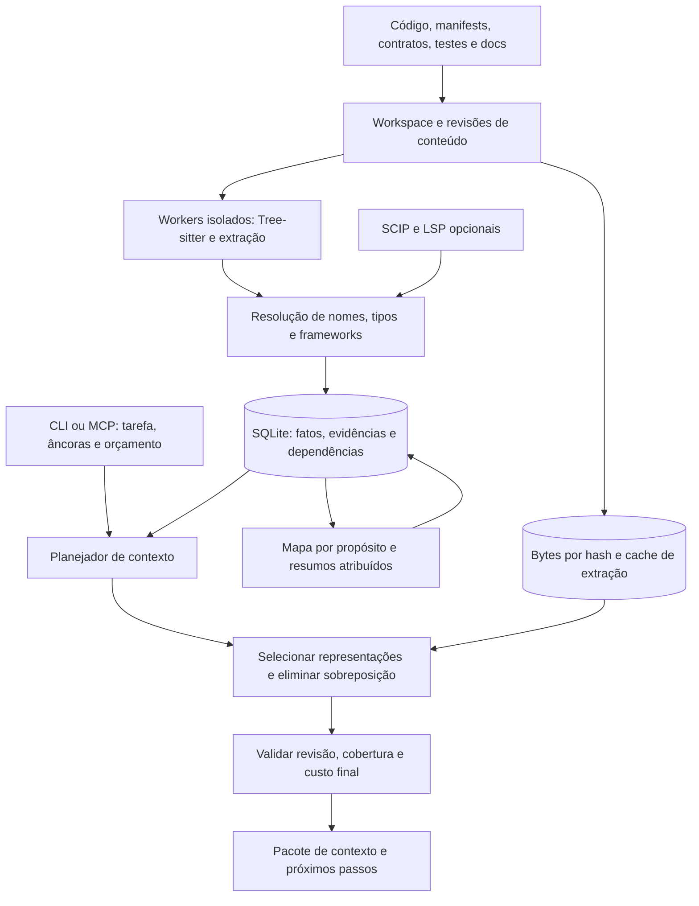

# RFC-0001 — Arquitetura do xrai

Data: 11/10/2026. Estado arquitetural: **proposta**. O scaffold L0 tem implementação local; as capacidades descritas nesta RFC continuam propostas até seu aceite. Evidências em [STATUS-IMPLEMENTACAO.md](STATUS-IMPLEMENTACAO.md); nenhum desempenho competitivo medido.

Linguagens iniciais confirmadas: **Rust, TypeScript/JavaScript, Python e Go**.

Plataformas do **v1 definidas pelo usuário: Linux x86_64 e macOS arm64**. A [decisão de plataformas](decisoes/PLATAFORMAS-V1.md), ADR 020, substitui a matriz inicial mais ampla desde M0 até a alpha/v1; Windows fica para depois.

## 1. Tese

O xrai deve produzir **o contexto necessário para uma tarefa, com evidências, revisão e limites explícitos**. O agente começa com orientação curta e expande apenas as dúvidas que restam.

O resultado buscado é **maior taxa de tarefas concluídas corretamente, com aumento de custo proporcional e limitado**. Essa prioridade foi definida pelo usuário: qualidade vem antes de economia. Tokens, latência e número de chamadas são métricas auxiliares; reduzir contexto enquanto se perde um requisito relevante é regressão. Custo por tentativa e por sucesso funcionam como limites, não como licença para escolher uma variante que resolve menos tarefas.

O [estudo comparativo de oito projetos](ESTUDO-COMPARATIVO.md) mostra que Rust, execução local, grafo, resumos, atualização incremental, SCIP/LSP, memória e orçamento de tokens já existem nessa categoria. A aposta do xrai é combinar essas capacidades com contratos verificáveis e semântica profunda nas linguagens prioritárias. Superioridade precisa aparecer no resultado das tarefas; não decorre da lista de tecnologias.

## 2. Requisitos e fronteiras

| Requisito | Compromisso proposto |
|---|---|
| Rust | Núcleo e CLI em Rust; bibliotecas C incorporadas são compatíveis com esse objetivo |
| Linux x86_64 e macOS arm64 no v1 | Um executável nativo por alvo; Windows e demais arquiteturas serão reavaliados após v1 |
| Binário único | Parsers, consultas e armazenamento incorporados; uso básico sem Node, Python, Go, Git CLI, compilador, LSP ou serviço externo |
| Sem GUI | CLI para humanos e automação; MCP stdio para agentes |
| Operação local | Indexação, busca e montagem de contexto sem rede ou modelo obrigatório |
| Grandes bases | Indexação incremental, memória limitada, travessias delimitadas, índices persistentes e cancelamento |
| Precisão | Toda afirmação estrutural rastreável; lacunas e ambiguidade observáveis |
| Código em edição | Arquivos alterados, não rastreados, renomeados, removidos e worktrees tratados explicitamente |
| Agnóstico de agente | Mesma API de domínio para CLI e MCP; integração não depende de um hook exclusivo |
| Conhecimento | Código, contratos, configurações relevantes, testes, documentação e decisões com validade vinculada às fontes |

“Binário único” não proíbe criar banco e cache nem iniciar workers do mesmo executável. Proíbe exigir outro programa para a experiência básica. Importar um arquivo SCIP mantém o runtime autônomo; gerá-lo com um compilador externo pertence a outro ambiente. Usar LSP é um modo opcional com dependências externas declaradas.

Primeira versão: navegar, buscar, preparar contexto, examinar relações e mudanças. Edição automática de código, GUI, mineração automática de conversas e execução de builds não são necessárias para entregar esse valor.

## 3. Arquitetura geral

Monólito modular, um executável. Modo pontual para comandos; processo duradouro quando o cliente inicia `xrai mcp`. Watcher opcional no processo duradouro. Um daemon separado só se medições de múltiplos clientes justificarem.



SQLite é o catálogo e a autoridade transacional dos fatos. Bytes de fonte são imutáveis por hash, armazenados no banco no início; um armazenamento separado poderá ser introduzido se I/O e tamanho justificarem. Markdown é exportação legível, regenerável, identificada por revisão.

## 4. Modelo de conhecimento

### 4.1 Entidades e relações

Entidades iniciais: workspace, pacote, módulo, arquivo, símbolo, ocorrência, configuração, contrato, teste e documento. Frameworks acrescentam endpoint, evento, tabela e outros tipos através de namespaces versionados.

Relações: contém, importa, referencia, chama, implementa, herda, lê, escreve, registra, produz, consome, documenta e testa. `calls` e `references` são distintas. Uma referência SCIP não vira chamada só por estar dentro de uma função.

Uma aresta é uma afirmação apoiada por uma ou mais evidências. Duas ferramentas podem concordar ou discordar sobre o mesmo par de entidades; preservar ambas as observações permite investigar a divergência.

Cada afirmação registra:

- Revisão, origem, versão do produtor e configuração de análise.
- Arquivo, hash de bytes e intervalo da ocorrência que a sustenta.
- Método: sintático, resolução semântica, regra de framework, observado em execução ou inferido.
- Condições: target, feature, build tag, configuração e ambiente quando conhecidos.
- Estado: resolvido, conjunto de candidatos, externo identificado ou não resolvido, com motivo.
- Dependências usadas na derivação, para invalidar corretamente.

Pontuação de ranking não é confiança da relação. Confiança categórica não é probabilidade. Probabilidades só entram após calibração em corpus separado, por tipo de relação e domínio. Mesmo um resultado de compilador vale para as entradas e configurações que ele analisou.

### 4.2 Identidade

Separar três identidades:

| Identidade | Finalidade |
|---|---|
| Chave semântica | Linguagem + pacote/versão + módulo + símbolo qualificado + distinção de overload/escopo |
| Ocorrência numa revisão | Arquivo + hash de conteúdo + intervalo de bytes + chave semântica |
| Linhagem entre revisões | Correspondência provável ou confirmada após edição, renomeação ou movimento |

Intervalos internos em bytes; linhas/colunas para apresentação. Converter UTF-8/UTF-16 conforme protocolo externo, sem usar conversão com perda como identidade. Um nome de função ou número de linha sozinho não é ID estável. Ambiguidade em linhagem exige novo ID ou candidatos; não unir silenciosamente símbolos homônimos.

### 4.3 Camada conceitual

Construir primeiro um mapa determinístico a partir de pacotes, entrypoints, exports, contratos e relações. Comunidades no grafo podem sugerir agrupamentos, sem afirmar que a estrutura detectada representa o domínio de negócio.

Documentação e ADRs humanos são fontes atribuídas. Resumos por modelo são anotações derivadas, opcionais, com trechos citados e versão do gerador. A validade depende dos hashes de todas as fontes utilizadas, incluindo contratos e dependências relevantes; apenas o hash do corpo da função não basta.

Para tarefas de alteração, exigir evidência de fonte e contratos. Um resumo ajuda a encontrar o caminho; sua fluência não comprova o comportamento. Notas humanas vivem fora do cache regenerável e sobrevivem a um rebuild.

Separar **propósito** (por que a área existe) de **resumo estrutural** (o que seus arquivos contêm), seguindo a distinção do ProjectAtlas. Propósitos têm escopo, autor, origem, estado de revisão e fontes de apoio. Aprovação por agente e por humano são estados distintos. Uma sugestão gerada permanece sugestão; envelhecimento e mudanças relevantes marcam necessidade de revisão, sem apagar a intenção registrada.

Navegação proposta: `propósito → área responsável → contrato/símbolo → fonte exata`. É uma opção para perguntas amplas; uma âncora exata vai diretamente ao símbolo. Resumos determinísticos de Cargo.toml, package.json, tsconfig, pyproject.toml, go.mod, contratos e docs também orientam a busca. Não exigir que todo arquivo tenha propósito curado antes de usar a ferramenta.

### 4.4 Experiência de investigação, opcional e posterior

Guardar tentativas, hipóteses, falhas e resultados como registros atribuídos, separados do grafo de fatos do programa. Cada registro informa tarefa, escopo, revisão, fontes e tipo de validação: relato do agente, revisão humana ou recibo de teste importado. Um recibo é observação daquela execução, não garantia de comportamento universal.

Alteração das dependências de uma nota provoca revalidação. Frequência de uso não aumenta sua autoridade; expiração temporal sozinha também não verifica correção. A memória serve para sugerir uma investigação útil ou alertar sobre uma tentativa anterior, com fonte acessível. Compartilhar experiências entre clientes ou exportar convenções exige operação explícita. Não minerar conversas automaticamente. Esta extensão fica depois da validação do núcleo de recuperação.

## 5. Sintaxe e semântica

### 5.1 Reaproveitar Tree-sitter

Incorporar runtime, gramáticas e consultas ao executável. Gramáticas são compiladas na fabricação do release; o usuário não precisa de compilador. O projeto fornece parsing incremental e recuperação diante de erros. [Documentação](https://tree-sitter.github.io/tree-sitter/), [bindings Rust](https://docs.rs/tree-sitter/latest/tree_sitter/).

O trabalho próprio deve começar **acima do parser**: escopos, bindings, módulos, relações, invalidação e seleção de evidências. Reescrever o parser passa a fazer sentido se um benchmark mostrar um bloqueio concreto de precisão, memória, desempenho ou manutenção que não possa ser resolvido com extensão ou substituição pontual.

### 5.2 Interface semântica comum, detalhes por linguagem

Extratores produzem fatos com posições, escopos, declarações, referências, imports e candidatos a chamadas. Resolvers recebem esses fatos, contexto de pacote e configuração. Uma representação comum permite consultas; dados específicos de linguagem permanecem disponíveis, sem forçar todos os sistemas de tipos a um modelo simplista.

| Família | Primeira resolução útil | Dificuldades que precisam aparecer na cobertura |
|---|---|---|
| Rust | `mod`, `use`, reexports, aliases, crates, funções e impls diretamente identificáveis | `cfg`, features, macros, proc macros, traits, genéricos, `dyn`, código gerado e build scripts |
| TS/JS | ES modules, CommonJS reconhecível, barrels, `exports`, aliases de tsconfig e escopos | exports condicionais, inferência de tipos, decorators, callbacks, JSX e imports dinâmicos |
| Python | Imports absolutos/relativos, pacotes, aliases, escopos e funções conhecidas | Namespace packages, `sys.path`, monkey patching, decorators, metaclasses e imports dinâmicos |
| Go | Módulos/workspaces, pacotes, aliases, funções, métodos e receptores identificáveis | Build tags, GOOS/GOARCH, interfaces, embedding, reflexão, cgo e código gerado |

Lançar uma matriz por capacidade e por versão: descoberta, símbolos, imports, referências, chamadas, tipos e frameworks. Cada célula tem fixtures e medição. Não promover uma linguagem inteira a “precisa” porque alguns imports resolveram.

Registrar cobertura também por arquivo e consulta: processado, parcial, excluído, falha, desatualizado ou capacidade ausente, com motivos e intervalos quando disponíveis. Uma extração vazia válida difere de parser ausente. Consultas sem capacidade suficiente oferecem busca textual delimitada e leitura de fonte. Essa busca pode localizar candidatos, mas não se apresenta como resolução semântica.

Não executar `build.rs`, proc macros, generators, imports Python, scripts npm ou comandos Go durante a indexação básica. Consumir artefatos existentes quando forem compatíveis e conhecidos. O relatório deve indicar o que isso deixa de analisar.

### 5.3 Escalonamento de precisão

1. Extração sintática e resolução lexical/local.
2. Resolução de módulos e tipos suportados, usando manifests e dependências disponíveis.
3. Integrações de frameworks e contratos declarados.
4. Importação opcional de SCIP e consulta opcional de LSP.
5. Dados de execução/testes importados, identificados como observações daquela execução.

Cada nível acrescenta evidências; não apaga ambiguidades sem justificativa. Para despacho dinâmico, retornar conjunto de candidatos e desconhecidos. “Nenhum uso encontrado” significa nenhum uso no escopo analisado; não prova que a mudança seja segura.

SCIP é intercâmbio, não motor semântico nem garantia automática de atualidade. Verificar manifest de entrada, hashes, configuração e versão do produtor. Um índice sem vínculo verificável às fontes entra como não verificado. [Protocolo SCIP](https://github.com/scip-code/scip).

### 5.4 Entre linguagens

Relacionar símbolos através de **entidades de contrato**, por exemplo:

```text
cliente TS → operação OpenAPI → rota Go → handler → modelo
produtor Rust → mensagem Protobuf → consumidor Python
campo GraphQL → resolver → acesso a dados
```

Uma coincidência de nome ou URL não basta. Considerar serviço, protocolo, método, host/base path, versão, aliases e ambiente. Correspondências parciais produzem candidatos. Integrações precisam declarar framework e versões reconhecidas; configuração calculada em runtime permanece uma lacuna.

Começar por OpenAPI/Protobuf e uma ligação concreta entre dois serviços do corpus. Escolher os primeiros frameworks depois dessa prova, sem multiplicar plugins superficiais. Regras compiladas e declarativas são suficientes inicialmente; uma ABI de plugins executáveis fica para uma necessidade comprovada.

## 6. Consistência e atualização incremental

### 6.1 Pipeline de alteração

1. Descobrir candidatos via watcher, reconciliação do inventário e mudança de manifests/configuração.
2. Ler bytes e calcular hash; extrair do mesmo buffer que será associado à revisão.
3. Reutilizar extração por `(content_hash, language/dialect, grammar_fingerprint, extractor_fingerprint, parse_config)` quando válido.
4. Resolver novamente os fatos afetados pelo ambiente e pelas dependências alteradas.
5. Persistir geração em preparação; publicar geração consultável de forma atômica.
6. Invalidar resultados, resumos e evidências dependentes; manter tombstones necessários a sessões antigas.

O cache sintático pode ser compartilhado entre worktrees. A resolução não pode ser compartilhada apenas pelo hash do arquivo: path, pacote, configuração e dependências também contam.

Rastrear dependências de resolução **positivas e negativas**. Se um import não existia e um novo arquivo passa a atendê-lo, sua resolução precisa ser refeita. Alterar um export, alias, manifest, lockfile, feature ou build tag pode invalidar muitos arquivos sem alterar seus bytes.

Quando não houver dependências precisas, invalidar conservadoramente o pacote ou workspace. Nunca apresentar invalidação parcial como equivalência a um rebuild completo.

### 6.2 Revisões e frescor

Toda resposta usa uma geração e os bytes correspondentes. Relações antigas não são combinadas com fonte recém-lida. Se o arquivo mudou, atualizar e reiniciar a consulta, ou devolver o snapshot anterior com sua revisão e estado explícitos.

| Modo | Significado |
|---|---|
| `snapshot` | Responde exatamente sobre uma geração já publicada |
| `validated` | Valida conteúdo e dependências pertinentes à consulta, reconcilia mudanças conhecidas e informa escopo/instante da validação |
| `strict` | Exige validação completa do escopo declarado; se não concluir, responde com estado de insuficiência |

Watcher é um aviso, não prova. Overflow, eventos perdidos, pastas em rede, checkout, symlinks e timestamps preservados exigem reconciliação. Hash é verificado para os bytes entregues. Busca global/impacto não pode alegar frescor global com base somente nos arquivos retornados.

Um working tree mutável não oferece snapshot atômico de todos os arquivos. Detectar mudanças durante a leitura, tentar novamente dentro de limite e declarar instabilidade se necessário. Para reprodutibilidade forte, preferir commit imutável ou conjunto de blobs capturado. Buffers não salvos só existem para o xrai se um cliente fornecer overlay versionado.

### 6.3 Concorrência e falhas

Um escritor por índice, leitores com snapshot transacional e fila limitada. Parsing nativo usa pool limitado de subprocessos do próprio executável, inspirado no tokensave. O pai captura bytes e hash; o worker recebe aquele conteúdo e devolve fatos associados à mesma entrada. Não reler livremente o working tree no worker e depois atribuir o resultado a outro snapshot.

O supervisor limita bytes em trânsito, filas, workers e duração por arquivo. Identifica requisição, versão de protocolo e fingerprint do produtor; valida tamanho e identidade das respostas antes de persistir. `abort`, falha nativa ou timeout encerra o trabalho daquele arquivo, reinicia o worker com limite e registra a lacuna. Um arquivo que falha repetidamente não causa loop de respawn. O processo pai e consultas já publicadas permanecem disponíveis. Esse desenho contém falhas; não substitui sandbox do SO.

Resolução e montagem usam paralelismo limitado quando apropriado; o executor assíncrono de MCP não executa parsing bloqueante. Cancelar uma consulta não cancela automaticamente indexação compartilhada necessária a outro cliente. Trabalhos compartilhados têm identidade, consumidores e dono da publicação. Panic/erro não autoriza reaproveitar relações obsoletas como atuais.

Timeout devolve dados parciais somente com estado explícito. Cache corrompido é reconstruível. Notas humanas e configuração não são cache e precisam sobreviver. O armazenamento reside em disco local; WAL não é adequado a compartilhamento de banco entre máquinas via filesystem de rede. [SQLite WAL](https://www.sqlite.org/wal.html).

### 6.4 Reaproveitamento entre worktrees

Cada checkout tem identidade e estado gravável próprios. Compartilhar blobs e extração imutável evita trabalho repetido; não usar um único grafo mutável para branches divergentes. Toda consulta captura workspace/worktree/revisão antes de iniciar, sem depender de um diretório corrente global alterável.

Uma otimização posterior pode hidratar um índice novo a partir de snapshot derivado compatível. Validar schema, capacidades, configuração e inventário de fontes; reconciliar branch, arquivos modificados, remoções e arquivos não rastreados antes de publicar. Não herdar recibos de contexto ou histórico de consumo de outra sessão. Falha de compatibilidade recai em indexação normal. Medir vantagem de hidratação contra rebuild; não introduzir catálogo global e daemon só para possibilitar cache.

## 7. Planejador de contexto

### 7.1 Entrada

`intent`, descrição, âncoras opcionais de símbolo/arquivo, diff, stack trace/diagnóstico, escopo, revisão, orçamento, perfil de tokenização e recibo de contexto conhecido.

Intenções iniciais: localizar, entender, corrigir, revisar e avaliar impacto. O agente pode informá-las explicitamente; classificação local determinística fornece um default inspecionável. Não exigir outra chamada a modelo para cada recuperação.

### 7.2 Execução

1. Aplicar escopo, exclusões, revisão e capacidades antes de ranquear.
2. Buscar nomes exatos, caminhos, subpalavras e texto; incluir documentação/contratos relevantes.
3. Fundir sinais lexicais, relações tipadas e proximidade às âncoras. Embeddings são um canal opcional.
4. Montar obrigações de evidência por intenção: trecho alterado, definição relevante, contrato afetado, condição de controle e testes pertinentes.
5. Produzir alternativas por candidato: localização, assinatura, trecho, símbolo completo ou arquivo completo.
6. Selecionar conjunto por ganho marginal de cobertura/custo; eliminar intervalos sobrepostos.
7. Validar bytes, relações, orçamento final e omissões. Retornar próximos passos que resolvam dúvidas específicas.

Para revisão, receber o diff diretamente. Para uma mudança no meio de um módulo grande, selecionar os hunks e contexto estrutural necessário, sem limitar a resposta às primeiras linhas. Arquivo pequeno pode ser a representação mais barata e compreensível.

### 7.3 Objetivo de seleção

Resolver uma aproximação de cobertura ponderada com custo e alternativas de representação. Requisitos identificados como obrigatórios vêm antes dos itens opcionais. Depois, maximizar relevância, diversidade útil e evidência adicional por token, penalizando duplicação, distância pouco informativa e fontes incertas.

O orçamento é global; não dividir permanentemente em percentuais fixos para código, testes e dependências. Uma tarefa de configuração pode exigir principalmente manifests; uma falha de contrato pode exigir testes e consumidores.

Não há algoritmo que saiba antecipadamente todo o contexto necessário a qualquer tarefa. As obrigações são um modelo explícito e avaliável. Se as obrigatórias não couberem, responder `insufficient_budget`, listar o mínimo ainda necessário e oferecer continuação. O retorno não vira “completo” só porque gastou todos os tokens.

O plano de consulta também tem orçamento de CPU, I/O, tempo, candidatos e expansões. Um resultado de 2 mil tokens pode exigir trabalho excessivo se a busca atravessar todo o grafo sem limite.

### 7.4 Recortes de programa

Primeira etapa: trechos AST com assinatura, bloco envolvente, condições pertinentes e linhas originais. Não concatenar trechos distantes como se fossem código contínuo. Preservar retorno antecipado, tratamento de erro e cleanup quando envolvidos.

Etapa avançada: fluxo de controle/dados intraprocedural e slicing por demanda, depois entre procedimentos selecionados. Cada frontend define seu suporte. Um slice aproximado pode perder efeitos, aliases ou dispatch; precisa declarar a limitação e permitir expansão ao símbolo completo. Não prometemos slicing semanticamente completo para todas as linguagens.

### 7.5 Contabilidade

Contar a **resposta final serializada**, incluindo metadados, fontes, marcadores de omissão e wrappers controlados pelo xrai. Deduplicar intervalos por arquivo e hash, inclusive entre classe/módulo e seus membros.

Usar tokenizer exato quando disponível e identificado. Para modelo sem tokenizer disponível, declarar estimativa e margem; não chamar isso de limite exato de tokens. Testar também tamanho em bytes. O xrai não controla wrappers acrescentados pelo cliente nem o restante da conversa.

A métrica de sessão soma descoberta de ferramentas, instruções de integração, todas as rodadas, respostas, tokens repetidos, cache de prompt e custo opcional de enriquecimento. Contar apenas a primeira resposta cria economia fictícia.

Além do limite por resposta, aceitar orçamento agregado opcional por `(client_id, session_id, task_id, context_epoch)`. Reservar cota para chamadas concorrentes e reconciliar o consumo real do payload. Inatividade não prova começo de turno, e processos MCP compartilhados não implicam orçamento compartilhado entre agentes. Sem identificação explícita, limitar cada resposta e informar ausência de contabilidade agregada confiável. Usage completo do modelo depende de dados fornecidos pelo cliente/harness, não pode ser deduzido apenas das respostas do xrai.

JSON compacto é o formato estável inicial. Texto estruturado e codecs como TOON/MUNCH são alternativas de apresentação a testar. Menos bytes não garantem menos tokens ou melhor entendimento; não adotar formato especializado sem medir tokenizer, parsing pelo agente e chamadas adicionais.

### 7.6 Mudanças como comparação entre dois estados

Uma revisão informa `base` e `head`; este pode ser um snapshot capturado do working tree. Comparar fatos e ocorrências nos dois estados, preservando nós e arestas removidos. Um consumidor anterior pode ser justamente o impacto que desaparece ao consultar apenas o índice novo.

Produzir alterações de assinatura, export, configuração, contrato e relações, além de hunks de texto. Correspondência de símbolos após rename/move mantém seu grau de certeza. Sem base disponível, entregar análise do estado atual com limitação explícita; não apresentar impacto histórico completo.

Incluir evidência do caminho `alteração → relação afetada → consumidor/teste`, delimitando sentido, condições e revisão de cada passo. Fluxos completos só são afirmados quando sustentados; comunidades, centralidade e coalteração no Git são sinais de prioridade, não prova causal.

### 7.7 Testes recomendados com evidência

O planner pode produzir um manifesto de testes: identificador/suíte, motivo, caminho a partir da alteração, configuração, revisão e origem da relação. Combinar relações estáticas com cobertura de execução importada quando esta estiver vinculada às fontes e ao ambiente corretos. Cobertura identifica o que foi observado, não todos os caminhos possíveis.

Distinguir duas operações: **priorizar testes prováveis** e **justificar uma seleção que omite outros testes**. A segunda exige política conservadora, inventário e diff suficientes; despacho desconhecido, mudança de infraestrutura de testes, contrato global ou cobertura incompatível ampliam a suíte recomendada. Devolver motivos como `selection_incomplete` e `run_broader_suite`, nunca um vazio interpretável como dispensa de testes.

O núcleo recomenda e importa evidências; não precisa executar os testes. Comandos eventualmente sugeridos vêm de configuração atribuída e seguem sujeitos à decisão do agente/usuário que os executará. O manifesto acompanha `context`/`impact`, sem criar dezenas de ferramentas MCP.

## 8. Contrato de resposta

Exemplo **ilustrativo**, sem resultado medido, de metadados de um pacote:

```json
{
  "schema_version": 1,
  "snapshot_id": "ws:demo/gen:42",
  "status": "insufficient_budget",
  "freshness": {"mode": "validated", "scope": "services/payments"},
  "budget": {"requested": 4000, "used": 3810, "unit": "tokens", "counting": "exact", "tokenizer": "example-v1"},
  "coverage": {
    "required_evidence": {"identified": 6, "included": 5},
    "unresolved_relations": 1,
    "excluded_files": 2
  },
  "items": [{"id": "e:17", "view": "excerpt", "reason": "changed_branch", "source_hash": "example-hash"}],
  "omissions": [{"id": "e:31", "reason": "budget", "required": true}],
  "unknowns": [{"kind": "dynamic_dispatch", "at": "e:17"}],
  "next": [{"operation": "expand", "ids": ["e:31"], "estimated_tokens": 650}]
}
```

O pacote real inclui texto e intervalos de fonte; o exemplo mostra apenas o envelope. `partial` é reservado a outros limites, como cobertura semântica. O schema deverá validar essa distinção.

Separar três coberturas: arquivos elegíveis indexados; relações que puderam ser resolvidas; evidências selecionadas efetivamente entregues. Nenhuma delas mede sozinha a compreensão do agente. Denominadores, escopo e motivos de exclusão devem acompanhar os contadores.

Cobertura semântica calculada sobre ocorrências reconhecidas não conhece automaticamente as relações que o extrator deixou de enxergar. Recall real é medido no corpus; o relatório operacional informa suporte e limites conhecidos. Resultados positivos também carregam lacunas pertinentes. Candidatos heurísticos ficam separados de relações resolvidas, inclusive em travessias e seleção de testes.

Evitar um placar “97% preciso” que misture frescor, ranking e completude. O agente precisa saber a natureza da dúvida para decidir o próximo passo.

## 9. CLI e integração com agentes

Sintaxe proposta, ainda não implementada:

```sh
xrai index .
xrai status --capabilities
xrai map --tokens 1200
xrai search 'PaymentService'
xrai context 'corrigir reembolso duplicado' --intent fix --tokens 4000
xrai context --intent review --diff change.patch --tokens 6000
xrai inspect <symbol-id> --view source
xrai impact <symbol-id> --tokens 2500
xrai impact --base <commit> --head worktree --tests --tokens 3000
xrai expand <context-id> --items e:31 --tokens 1500
xrai export --format markdown --out ./xrai-map
xrai mcp --stdio
```

Todas as consultas aceitam formato estável JSON; texto humano é a projeção padrão em TTY. Saída de dados em stdout, logs/progresso em stderr. Cancelamento, exit codes e estados parciais fazem parte do contrato. `index` funciona sem repositório Git.

Superfície MCP inicial: `context`, `search`, `inspect`, `relations`, `expand`, `status`. `relations` oferece usos, chamadas e impacto por enum pequeno. Batch recebe orçamento agregado e evita N respostas ilimitadas. Um roteador genérico com dezenas de opções também pode custar caro; medir schema e erro de escolha de ferramenta antes de expandir a API.

MCP e CLI chamam o mesmo motor, com testes de equivalência. Usar [SDK oficial Rust RMCP](https://github.com/modelcontextprotocol/rust-sdk), com negociação de capacidades e compatibilidade testada nos clientes alvo. Não presumir que todos os clientes suportam os mesmos resources, hooks, notificações ou formatos.

Integração inicial imprime configuração/snippet curto. Uma operação explícita de instalação pode aplicar alterações idempotentes aos arquivos do cliente, com preview e rollback. Consultar código não modifica instruções globais. Hooks aceleram atualização quando disponíveis; a correção não depende deles.

A orientação ao agente ensina quando localizar, inspecionar, expandir e conferir cobertura. Fallback para leitura/busca textual permanece disponível. Medir o comportamento induzido por essa orientação: uma ferramenta econômica por chamada pode gerar mais rodadas e aumentar o custo total.

### Sessões e leitura repetida

Opcionalmente o cliente informa recibos de `(conteúdo, revisão, nível entregue, epoch de contexto)`. O servidor pode devolver apenas alterações e um resumo de reentrada. O agente pode pedir `full` a qualquer momento.

Entregar conteúdo numa chamada anterior não prova que ele ainda esteja no contexto do modelo. Após compactação, novo agente ou ausência de confirmação, voltar ao modo autossuficiente. Deduplicação entre agentes compartilha computação e índice; não assume memória compartilhada.

## 10. Implementação Rust e armazenamento

### Organização inicial

Cinco crates bastam para começar; as pastas abaixo foram criadas no scaffold L0. As APIs e os subsistemas continuam planejados para seus cartões, sem implementação antecipada:

```text
crates/
  xrai-core/       # IDs, fatos, revisões, capacidades e contratos
  xrai-index/      # workspace, parsers, linguagens, resolvers, persistência
  xrai-query/      # busca, relações, seleção, orçamento e projeções
  xrai/           # executável, CLI, MCP e integrações
  xrai-eval/      # harness, datasets e relatórios
```

Extratores são módulos por linguagem inicialmente. Separar crates adicionais quando fronteiras de compilação, dependências ou ownership justificarem. Tipos do domínio não dependem de MCP nem do formato de apresentação.

### Dependências propostas

| Área | Escolha inicial | Trade-off |
|---|---|---|
| CLI/formato | `clap`, `serde`, `serde_json` | Ergonomia e schemas; vigiar tamanho e estabilidade da superfície |
| Parsing | `tree-sitter` e gramáticas incorporadas | Bom alcance sintático; semântica própria e FFI a manter |
| Persistência | `rusqlite` com SQLite incorporado; FTS5 | Transações e operação simples; um escritor e necessidade de índices bem projetados |
| Filesystem | `ignore`, `notify`, hashes BLAKE3 | Descoberta e avisos; reconciliação continua necessária |
| Concorrência | Supervisor de workers do mesmo executável; `rayon` para trabalho Rust apropriado; `tokio` na fronteira | Custo de IPC/startup versus contenção de falhas; limitar todos os pools |
| MCP | `rmcp` | Protocolo pronto; versões negociadas e testadas |
| Git | Avaliar `gix` ou `libgit2` incorporado em spike | Evitar Git CLI obrigatório; validar worktrees, ignores, packs e casos reais |
| Grafos | Arestas indexadas em SQLite; adjacências em memória sob demanda | Evita carregar o grafo inteiro; travessias precisam de limites |

Bibliotecas e versões exatas serão fixadas após spike de compilação nos SOs alvo. SQLite incorporado evita depender da versão instalada no sistema; FTS5 oferece índice textual e ranking. [Rusqlite](https://github.com/rusqlite/rusqlite), [FTS5](https://sqlite.org/fts5.html), [ignore](https://github.com/BurntSushi/ripgrep/tree/master/crates/ignore), [notify](https://docs.rs/notify/latest/notify/), [BLAKE3](https://docs.rs/blake3/latest/blake3/).

FTS5 precisa de tokenização adequada a nomes `camelCase`, `snake_case`, caminhos e nomes qualificados. Indexar forma original e subpalavras. Busca literal delimitada em arquivos continua disponível para strings/configurações ou conteúdo não indexado. Embeddings ajudam em descrições sem correspondência lexical, inclusive português versus código em inglês, mas só entram se o benchmark demonstrar ganho.

Tantivy, armazenamento especializado de grafos, Salsa e vetores ficam como alternativas avaliáveis, não dependências obrigatórias iniciais. Uma camada de queries incremental própria pode começar simples; adotar Salsa se o spike mostrar benefício sobre o DAG explícito de dependências.

### Esquema lógico mínimo

`workspaces`, `generations`, `files`, `file_versions`, `source_blobs`, `entities`, `occurrences`, `assertions`, `evidence`, `derivation_inputs`, `capabilities`, `diagnostics`, `annotations` e índices de busca.

Propósitos são anotações tipadas. Inventário e diagnósticos sustentam cobertura mesmo quando nenhum símbolo é extraído. Manifestos de contexto/testes são derivados; histórico de investigações e recibos persistentes só ampliam o schema quando esses recursos forem implementados.

IDs densos internos para joins; IDs públicos independentes do rowid. Chaves estrangeiras e publicação transacional protegem integridade. Índices por origem/destino/tipo, símbolo/nome, arquivo/intervalo e revisão. Não persistir cada nó de CST sem uma consulta que justifique o custo.

Cache por workspace/worktree em diretório de cache do SO; configuração compartilhável em `xrai.toml` ou `.xrai.toml`. Permitir override de cache. Usar caminhos nativos internamente e apresentação estável; tratar case sensitivity, Unicode, symlinks e caminhos longos nos dois alvos do v1. Reparse points e adapters de paths Windows ficam pós-v1. Não normalizar nomes distintos para a mesma identidade.

### Distribuição

Pipeline de build/testes nativos desde M0 e release da alpha/v1 em **Linux x86_64** (`x86_64-unknown-linux-gnu`) e **macOS arm64** (`aarch64-apple-darwin`). O [ADR 020](decisoes/PLATAFORMAS-V1.md) fixa baseline Ubuntu 24.04/glibc 2.39 e piso macOS 15.0; M0-05/M1-20 verificam ABI, autonomia e bibliotecas do sistema exigidas. Linux musl é uma alternativa futura a medir, sem artefato adicional obrigatório. Windows, Linux arm64 e macOS Intel ficam fora dos gates e da distribuição do v1; sua inclusão exige decisão e validação próprias após v1.

Testar binários em ambientes limpos, sem runtimes auxiliares e sem rede. Medir tamanho, startup e memória. Reproduzir build e publicar checksums e inventário de licenças das gramáticas/dependências. Gramáticas compiladas podem aumentar o binário; medir antes de impor meta de tamanho.

## 11. Limites de confiança e uso de recursos

Arquivos, comentários e documentação do repositório são dados; não ganham autoridade para mudar configurações do agente ou executar comandos. A indexação básica não executa código do projeto. Excluir diretórios de dependências e segredos conhecidos por padrão, com configuração inspecionável; preservar contratos/configurações relevantes por inclusão deliberada.

Controlar tamanho de arquivo, profundidade de parse/travessia, memória, tempo, número de candidatos e volume de saída. Validar caminhos e fronteiras do workspace, inclusive symlinks. Guardar caches como dados locais sensíveis, pois podem conter código.

HTTP não é necessário ao núcleo. O modo inicial usa stdio; um transporte remoto futuro precisa de fronteiras e autenticação próprias. Provedores de embeddings/resumos externos só funcionam mediante configuração explícita. Nenhuma rede é necessária no modo autônomo.

## 12. Onde investir em bibliotecas próprias

| Investimento | Valor esperado | Condição para avançar |
|---|---|---|
| Motor de evidências e invalidação | Evita relações e resumos com fontes incompatíveis | Parte do núcleo inicial |
| Resolver incremental por linguagem | Melhora precisão onde AST e busca textual falham | Fixtures de semântica, métricas por capacidade |
| Seletor de contexto e representações | Preserva requisitos com menor volume | Vencer baselines a qualidade equivalente |
| Slicing por demanda | Entrega trecho causal de funções grandes | Ablation mostra ganho sem perda de acerto |
| Regras de contratos/frameworks | Recupera caminhos entre serviços e linguagens | Casos reais com identidade verificável |
| Parser novo ou type checker amplo | Autonomia e cobertura em casos não resolvidos | Bloqueio demonstrado e comparação com integrar um frontend existente |

Se o objetivo exigir semântica de compilador sem processos externos, incorporar ou desenvolver frontends nativos é um programa de engenharia próprio. Rust e Go já apresentam desafios grandes; TS e Python acrescentam outros. A arquitetura deve aceitar esse investimento sem anunciar precisão universal antes das medições.

Stack/scope graphs são boas referências para nomes, mas não substituem tipos, macros e dispatch. O projeto GitHub de stack graphs está arquivado; uma dependência nele exigiria manutenção assumida. [Fonte](https://github.com/github/stack-graphs).

## 13. Marcos e critérios de avanço

| Marco | Entrega | Critério para avançar |
|---|---|---|
| M0 — provar sinal | Corpus, finalistas competitivos, protótipos delimitados P2/P3 e spikes técnicos | G0: sinal repetido de ganho em tarefas reais, mecanismo explicado e viabilidade; libera só confirmação |
| M1-A — confirmar | Campanha reservada, sessões de agentes, ablations, configurações fortes e custo completo | G1: vantagem no domínio pré-definido; investir, focar, simplificar, estender uma vez ou encerrar |
| M1-B — entregar alpha | Quatro famílias, cobertura/fonte/busca, recortes semânticos aprovados, CLI/MCP e distribuição | G2: preservar ganho após integração; fonte por hash, incremental equivalente a rebuild, falha contida e autonomia |
| M2 — ampliar resolução | Aprofundar P2 onde há ganho; imports, tipos/dispatch, configurações e SCIP opcional | Ganho marginal por capacidade; precisão/lacunas por linguagem; manutenção sustentável |
| M3 — ampliar seleção | Aprofundar P3; propósito, novas tarefas, testes recomendados e orçamento por tarefa | Confirmar qualidade/custo em novos domínios; incerteza na seleção de testes explícita |
| M4 — atravessar sistemas | Contratos entre linguagens, primeiros frameworks e conhecimento derivado | Caminhos corretos em projetos reais; invalidação de mudanças contratuais |
| M5 — aprofundar | Slicing, recibos de sessão, memória atribuída, hidratação de worktrees e frontends mais ricos | Cada capacidade demonstra ganho incremental por ablation |

P2 antecipa semântica delimitada nas quatro famílias; P3 antecipa obrigações, consulta base/head e expansão por orçamento. Executam sobre snapshots capturados e adapters experimentais, sem depender do banco ou integração Git completos. M2/M3 amadurecem os componentes que demonstrarem ganho, em vez de receber a primeira prova da tese. Não fixar semanas sem equipe, corpus e resultados do spike.

Próximo trabalho concreto: usar D0/seed já preparados no harness, qualificar 32 desafios D1 em M0-03.R1 e triar os oito concorrentes. O [protocolo de diferenciação](PROVA-DE-DIFERENCIACAO.md) define comparadores fortes, separação de holdout, contabilidade e limites de esforço. A campanha reservada começa em M1-A, antes da alpha completa.

O [plano de implementação de M0/M1](PLANO-DE-IMPLEMENTACAO.md) detalha 35 tarefas principais, quatro atividades complementares e seus gates. G1 tem qualidade como única rota primária: ganho pontual de sucesso ≥8 pp, com superioridade sustentada pelo intervalo; limites superiores das razões de custo por tentativa ≤1,25 e por sucesso ≤1,15, sob a análise e os guardrails do protocolo. Os números são propostas de arquitetura; a prioridade de qualidade foi definida pelo usuário. Isso testa um domínio delimitado; não promete semântica universal nem liderança nas quatro famílias sem evidência.

## 14. Registro das decisões propostas

Os ADRs 001–018 permanecem **Propostos**, com concretizações nas revisões L0/L1. No ADR 019, prioridade de qualidade e separação de papéis são **definidas pelo usuário**; os limiares numéricos continuam propostas de arquitetura. O recorte de plataformas do ADR 020 também foi **definido pelo usuário**; seus pisos de SO e os ADRs 021/022 são **decisões do Arquiteto para execução**. Cada linha resume contexto, decisão, alternativa, consequência e revisão necessária. Proposto não exige nova permissão para cada tarefa: o usuário autorizou preparar o início da implementação dentro deste plano; alterações materiais devem ser registradas.

| ADR | Contexto e decisão | Alternativa e consequência | Validação/revisão |
|---|---|---|---|
| 001 | Distribuição autônoma: monólito modular Rust e CLI/MCP | Serviços externos aumentam operação; núcleo incorporado aumenta binário | Ambientes limpos em Linux x86_64 e macOS arm64 no v1 (ADR 020) |
| 002 | Parsing é infraestrutura: Tree-sitter incorporado | Parser próprio oferece controle, mas desloca esforço da semântica | Corpus de erros, tempo e memória |
| 003 | Persistir fatos e evidências em SQLite; Markdown como projeção | Arquivos como autoridade dificultam transações; DB exige schema e migrações | Rebuild, crash e consultas em escala |
| 004 | Revisões explícitas e dependências de derivação | Atualização eventual simples custa menos; pode misturar estados | Testes metamórficos e concorrentes |
| 005 | Resolução por linguagem com candidatos/unknowns | Unificação prematura simplifica APIs e cria falsas equivalências | Precisão por relação e linguagem |
| 006 | Núcleo sem LLM; enriquecimento opcional e atribuído | LLM obrigatório amplia descrições, traz custo e incerteza | Ablation e invalidação dos resumos |
| 007 | Orçamento global e obrigações de evidência | Top-k e percentuais fixos são simples; podem omitir partes obrigatórias | Qualidade versus custo em curvas |
| 008 | Léxico + grafo primeiro; embeddings opcionais | Vetores desde o início ajudam vocabulário, aumentam instalação/custo | Corpus com consultas conceituais e bilíngues |
| 009 | Superfície MCP pequena e API de domínio única | Muitas ferramentas especializadas facilitam alguns usos e aumentam schema | Custo de descoberta e erros de seleção |
| 010 | Session delta exige recibo/epoch; full sempre possível | Dedup automática parece barata, mas pode retirar contexto já compactado | Testes de compactação e troca de agente |
| 011 | Regras compiladas/declarativas inicialmente | WASM/plugins externos ampliam ecossistema e superfície de manutenção | Só abrir ABI com necessidade concreta |
| 012 | Crescimento guiado por maior sucesso, com limites de custo por tentativa/sucesso | Otimizar só tokens ou uma razão custo/qualidade pode favorecer respostas incompletas | Gates de qualidade e custo do protocolo; prioridade explicitada no ADR 019 |
| 013 | Workers de parsing do mesmo executável, bytes capturados pelo pai | Threads têm IPC menor, mas falhas nativas podem encerrar o servidor | Abort/timeout/OOM, startup e RSS agregado em Linux x86_64 e macOS arm64 no v1 |
| 014 | Separar propósito, estrutura e experiência de investigação | Memória única é simples, mas mistura intenção e evidência | Rebuild, atribuição, invalidação e erros de interpretação |
| 015 | Revisão compara base/head e preserva fatos removidos | Apenas head é mais barato e perde consumidores anteriores | Exclusões, renames e contratos removidos |
| 016 | Testes recomendados com evidência; omissão exige política conservadora | Alcance no grafo sozinho pode omitir testes relevantes | Falhas conhecidas, cobertura incompatível e fallback de suíte |
| 017 | Worktrees com estado próprio e cache imutável reutilizável | Banco gravável compartilhado simplifica armazenamento, mistura branches | Edições divergentes, recriação de checkout e equivalência a rebuild |
| 018 | Antecipar P2/P3 e confirmação competitiva em M0/M1-A; engenharia ampla só após G1 | Completar infraestrutura antes da prova reduz incerteza técnica, mas pode financiar produto sem ganho; protótipos custam descarte/reintegração | Finalistas fortes, holdout, ablations, custo completo, tetos e decisões do protocolo de diferenciação |
| 019 | Usuário prioriza sucesso com custo aceitável e separa arquiteto de implementador; qualidade é a única rota de avanço | Economia sozinha poderia aprovar produto menos útil; gasto irrestrito poderia comprar pouco ganho. Arquiteto planeja; outra IA implementa e mede | Proposta G1: ganho ≥8 pp, razões de custo por tentativa ≤1,25 e por sucesso ≤1,15 sob intervalos; handoff e estado locais |
| 020 | Usuário restringe v1 a Linux x86_64 e macOS arm64; Windows após v1 | Matriz ampla desde M0 consome trabalho de plataforma; foco em dois alvos mantém as exigências de qualidade e posterga outros ports | M0-02.R2 ajusta CI; M0-05/06/07/08 e M1-19/20 provam os dois alvos; [decisão e critérios](decisoes/PLATAFORMAS-V1.md) |
| 021 | Aceitar corpus inicial como D1-seed e qualificar 32 casos antes do piloto, com porte/complexidade, proveniência e oracles verificáveis | Aceitar bibliotecas pequenas como prova geral favorece pistas e tarefas simples; ampliar amostra agora aumenta custo. Preservar seed e substituir casos primários conforme critérios | M0-03.R1, M0-04/12 e H1; [admissão e recortes](decisoes/CORPUS-QUALIFICADO.md) |
| 022 | Lock de dono e fencing para staging; FTS externo no SQLite por conteúdo; retenção por pins persistidos | PID/tempo podem confundir dono vivo; texto por geração cresce; GC por idade quebra contextos. Acrescenta coordenação e joins que devem ser medidos | M1-04/15/16/19 após G1; [decisão, alternativas e falhas](decisoes/PERSISTENCIA-E-RETENCAO.md) |

### 14.1 Concretizações do lote L0 nos ADRs existentes

O [contrato mínimo v1](contracts/m1.md) e o [relatório L0](relatorios/L0.md) registram as escolhas locais abaixo. Elas especificam a execução dos ADRs; não tornam os recursos futuros disponíveis nem aprovam gates competitivos.

| ADR existente | Concretização e evidência responsável |
|---|---|
| 001, 003 | Workspace modular com cinco crates; Rust/MSRV 1.98.1, edição 2024. Esqueleto usa std, sem incorporar parser/banco antes dos respectivos spikes. [Compatibilidade, fontes e logs](relatorios/dependencias-L0.md); autonomia completa ainda em M0-05/M1-20. |
| 004 | IDs opacos vinculados ao checkout/revisão; paths nativos sem perda, BLAKE3 e spans `[start,end)`; snapshot/validated/strict distinguem geração, validação pertinente e escopo integral, sem atomicidade universal do working tree. Contrato §§1–4 e exemplos; implementação/validação de produção em M1-01/03/13. |
| 005 | Estados resolved/candidate/external/unknown discriminados; inventário, cobertura de relações, suficiência e suporte independentes. Matriz sintática por dialeto sem promover callsites a chamadas resolvidas. Contrato §§2–3/7–8; recortes P2 só promovidos por M1-23 após G1. |
| 007 | Payload serializado inteiro contado; obrigação omitida por orçamento gera insufficient_budget, conservando demais lacunas. Rejeição de admissão abaixo do envelope mínimo tem diagnóstico separado limitado. Contrato §5; exceção explícita enviada para análise em L0-A02, sem fingir cumprimento do teto pelo diagnóstico. |
| 009 | Seis operações MCP planejadas, anunciadas apenas após implementação; tipos e domínio separados dos adapters. L0 anuncia somente ajuda/versão. Contrato §§5–6; equivalência CLI/MCP continua aceite de M1-18. |
| 012, 019 | Correção de fonte/semântica e obrigações precede compressão. Limite por resposta, esforço experimental e autorização de gasto são conceitos distintos. Exemplos não comprovam vantagem; gates e orçamento de campanha seguem o protocolo. |

Política de licença do xrai permanece aberta (L0-A01); `publish=false` não escolhe licença em nome do usuário. A resposta do Arquiteto a A02 e a nova questão A03 estão na revisão abaixo; corpus e spikes independentes podem avançar.

### 14.2 Decisões da revisão arquitetural L0

A [revisão L0](relatorios/REVISAO-L0.md) aceita o scaffold/exemplos e define as concretizações abaixo para execução em M0-01.R1. São decisões de arquitetura nesta revisão; ainda não são código, schema atualizado ou comportamento de produto validado.

| ADR | Decisão | Alternativa e consequência | Aceite restante |
|---|---|---|---|
| 004 | Distinguir snapshot fixado e seleção explícita `latest`. ID fixo não sofre rebind; latest pode fixar nova geração após reconciliação, com identidade explícita | Exigir igualdade com o request em todos os casos impede expressar atualização; permitir rebind sempre quebra estabilidade. A separação conserva ambas as garantias | Fixtures de avanço, revisão desatualizada, novo arquivo, âncora incompatível e rejeição de mistura; produção em M1-01/13/16 |
| 007 | Aprovar diagnóstico de admissão separado quando o orçamento normal não comporta envelope; cap de 4096 bytes no diagnóstico da aplicação, zero fonte e custo contabilizado | Silenciar erro prejudica recuperação; furar o teto da resposta normal oculta custo. A exceção é tipada e limitada, sem promessa universal para framing/ID arbitrário | Precisar CLI/MCP/escapes/duplicação e estimativa de mínimo em R1; medir adapters/tokenizer nos cartões correspondentes |
| 009 | Restrição de orçamento com request bem formado é erro da ferramenta; erro estrutural de protocolo segue mecanismo do protocolo | Misturar os dois torna cliente incapaz de decidir recuperação | Versão MCP escolhida e integração verificadas em M1-18; decisão detalhada e fonte primária na revisão |

L0-A01 continua decisão do mantenedor antes de distribuição M1-20. A CI do commit L0 passou nos três hosts do scaffold; isso não encerra M0-05 ou M1-20. G0/G1/G2 permanecem sem resultado.

### 14.3 Resolução arquitetural L1

[Revisão L1 e lote L2](relatorios/REVISAO-L1.md): C01 resolvida pelo ADR 021; S01/S02 resolvidas pelo ADR 022. M0-03 aceito no escopo explicitamente reduzido a preparação inicial; qualificação competitiva transferida obrigatoriamente para R1. Persistência de produção segue após G1. Histórico e logs permanecem preservados.

## 15. Definições com responsável e momento

| Item | Responsável e regra vigente |
|---|---|
| Projetos/casos e frameworks iniciais | Implementador seleciona em M0-03.R1 pelos critérios do ADR 021; sem nova aprovação por candidato. Frameworks extras dependem de erro/ganho medidos. |
| Hardware, tamanhos e metas operacionais | Implementador inventaria máquina disponível em M0-04/05; fixa referência comparável antes do piloto e limites medidos em M0-10. Sem necessidade de comprar hardware para iniciar. |
| Profundidade semântica e enriquecimento | Recortes P2 e regimes do protocolo; ampliar apenas com ablation/ganho demonstrados. Não implementar type checker completo para cumprir uma lacuna abstrata. |
| Licença do produto | L0-A01, mantenedor, antes de distribuição M1-20; preservar `publish=false`. Não impede trabalho local. |
| Orçamento monetário | Mantenedor autoriza o teto antes do uso pago. Implementador entrega estimativa e manifest de campanha concretos; replay e preparação continuam. |
| Manutenção e tamanho de binário | Implementador mede nos spikes; M0-10 registra custos/limites e escopo sustentáveis. Não fixar prazo/equipe fictícios. |
| CI/runners | Bloqueio anterior superado após repo público: [CI do commit `9b5411c`](relatorios/CI-PUBLICO.md) concluiu R2/M0-07. Demais spikes e distribuição ainda exigem suas próprias provas. |

Não resta decisão arquitetural de L1 exigida para iniciar o lote L2. As verificações e decisões externas acima conservam seus respectivos responsáveis e gates.
