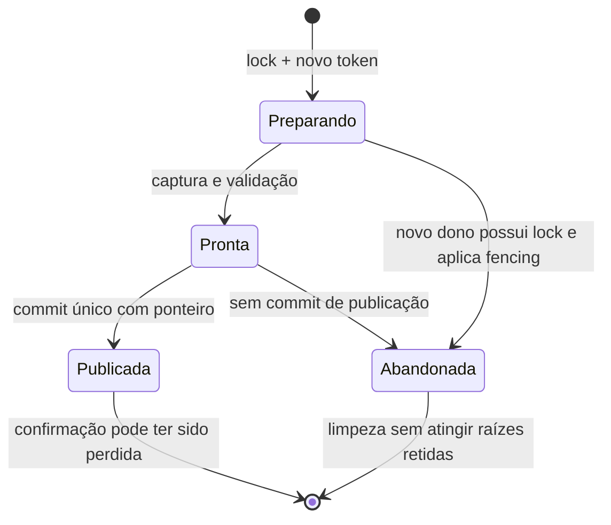

# Persistência, recuperação e retenção — ADR 022

Data: 11/10/2026. **Decisão do Arquiteto para L1-S01 e L1-S02.** Complementa ADRs 003/004/017. Implementação em M1-04/15/16/19, somente após G1. Não transformar o spike M0-07 em banco de produção agora.

## Base e decisão

O [spike L1](../relatorios/sqlite-L1.md) demonstrou localmente publicação transacional, leitores em A durante publicação B, rollback após morte confirmada e deduplicação de blobs. Não demonstrou recuperação automática, GC ou retenção de contextos. A cópia de texto na FTS por geração continua crescendo apesar de blobs iguais. CI nativa pendente permanece pendente.

Manter SQLite incorporado, WAL, blobs imutáveis e publicação por geração. Escolher **lock de processo com posse verificável e fencing**, em vez de inferir morte por PID/heartbeat. Escolher **FTS sobre conteúdo externo no próprio banco, deduplicado por versão**, e **pins persistidos para contextos/cursors válidos**. Os tópicos abaixo são requisitos de implementação; não descrevem recursos já existentes.

SQLite WAL permite leitores e um escritor simultâneos, exige processos no mesmo host e pode crescer quando leitores impedem checkpoint. Por isso o cache gravável deve ficar em filesystem local, mesmo quando a fonte vem de outro volume; transações de leitura não devem durar a sessão do agente. [Documentação WAL](https://www.sqlite.org/wal.html).

## L1-S01 — dono da tentativa e recuperação

O processo supervisor é o único que grava gerações. Workers recebem bytes capturados e devolvem resultados; não recebem conexão de escrita nem autoridade de publicação. Aplicar esta ordem:

1. Abrir a identidade canônica do índice e adquirir lock exclusivo do SO no arquivo estável `writer.lock`, por toda a tentativa de construção/manutenção. Não apagar ou substituir o arquivo de lock para “liberá-lo”; aliases do mesmo índice devem alcançar o mesmo lock. Handle não é herdado pelos filhos. A API/crate concreta é escolha local, comprovada nos dois alvos.
2. Em transação curta `BEGIN IMMEDIATE`, verificar application-id/schema e a encarnação do índice, incrementar `writer_epoch` e criar `attempt_id` aleatório. O token é `(index_incarnation, writer_epoch, attempt_id)`; PID, instante de início e heartbeat servem apenas a diagnóstico. Não usar timeout de heartbeat como autorização para roubar lock.
3. Toda transação que altera staging, gerações, publicação ou GC valida o token vigente. Resultados atrasados de workers ou tentativas antigas são rejeitados. O lock coordena o trabalho longo; SQLite arbitra gravações curtas. Nunca esperar o lock do SO enquanto mantém transação SQLite aberta.
4. Construir staging fora do universo consultável. Na publicação, validar fontes/fatos e trocar ponteiro publicado **na mesma transação** que marca a tentativa como publicada. Leitores fixam uma geração completa. Não usar a última geração numérica como sinônimo de publicada.
5. Ao adquirir legitimamente o lock após interrupção, inspecionar o commit: tentativa já publicada permanece publicada, mesmo se o processo morreu antes de responder ao cliente. Só staging não publicado de dono anterior, agora impedido pelo epoch, passa a abandonado e elegível para limpeza. Simples leitura de `pending` nunca autoriza recuperação.

Se o dono estiver pausado, vivo ou com lock inacessível, respeitar espera limitada e retornar diagnóstico de ocupado. Encerrar processo por solicitação explícita segue supervisão normal; PID reciclado ou relógio alterado não muda a posse. Filhos encerram ao perder o canal do pai, com deadline; ainda que sobrevivam, não podem publicar nem manter o lock.

Registrar pins de leitores é gravação curta e não exige o lock longo do indexador; usa transação SQLite própria. Esse caminho pode disputar o escritor SQLite e deve ter timeout/diagnóstico, sem bloquear indefinidamente a consulta. GC/rebuild que altera gerações segue o mesmo lock e token do indexador. Não permitir dois caminhos concorrentes de manutenção com regras diferentes.

Banco de encarnação/schema desconhecido não é recriado por abertura. Rebuild normal conserva fontes ainda prometidas aos contextos e notas humanas; uma troca explícita de encarnação invalida referências antigas de modo tipado e nunca reutiliza IDs. Troca maliciosa de path/symlink é tratada pelo contrato de identidade de M0-08/M1-04; advisory lock não é uma sandbox contra processos que o ignoram.

## L1-S02 — fonte, índices derivados e busca

Guardar bytes capturados uma vez por hash, conferindo igualdade/encoding; snapshots associam caminhos nativos a versões imutáveis de arquivo. Versões de símbolos/nomes têm identidade que inclui produtor/configuração pertinente. Um mesmo conteúdo usado em N snapshots não exige N cópias integrais de seu corpo no FTS.

A implementação inicial usará FTS5 de **conteúdo externo**: tabela/view no mesmo SQLite expõe texto dos blobs UTF-8 elegíveis, com rowid estável e fingerprint do tokenizer. Não é arquivo externo nem serviço. Índice de corpo é compartilhado por conteúdo/tokenizer; nomes/caminhos usam versões e memberships próprios. O índice trigram inicial cobre nomes/caminhos, sem replicar automaticamente todos os corpos. Fonte de encoding não suportado preserva bytes, diagnóstico e fallback contratado; nenhuma conversão com perda vira fonte canônica.

FTS5 admite tabela ou view como conteúdo externo e exige que a aplicação mantenha conteúdo e índice coerentes. Inserção, remoção e rebuild devem seguir suas regras; criar triggers não indexa retroativamente linhas existentes. [Documentação FTS5](https://www.sqlite.org/fts5.html#external_content_tables).

Garantias adicionais do xrai:

- Filtrar pela associação ao snapshot solicitado **antes de top-k/limite lógico**. Não selecionar hits globais limitados e depois descartar outras gerações, perdendo hits válidos. Conteúdo compartilhado pode mapear vários caminhos elegíveis; preservar as identidades.
- Cursor fixa revisão, consulta, versão do ranking e desempate. Estatísticas globais do FTS podem mudar quando outras gerações entram/saem; não usá-las para alterar silenciosamente a ordenação de uma revisão fixada. Começar com score lexical determinístico que dependa da consulta, documento e metadados da revisão; BM25 com estatísticas por snapshot só mediante necessidade medida. Esse é um requisito de estabilidade escolhido pela arquitetura.
- Limitar custo de consulta e explicitar truncamento/insuficiência se o trabalho não completar. Otimização não pode substituir cobertura correta por corte silencioso.
- Atualizar FTS e fonte na mesma transação; ao excluir conteúdo, fornecer os valores antigos exigidos pela FTS antes de remover o blob. Rebuild deriva somente de fontes capturadas, com checagem de consistência. Não reconstruir snapshot antigo lendo checkout atual.

A implementação pode ajustar tabelas, chunking e tokenização dentro dessas garantias. Promoção do layout duplicado do spike para produção ou armazenamento externo de blobs exige medição e registro de revisão desta decisão; não é a opção padrão por conveniência.

## Retenção e pressão de recursos

Raízes de retenção: geração publicada, gerações cobertas pela política anunciada, pins persistidos de contextos/cursors ainda válidos e tentativas ativas autorizadas. Contexto base/head fixa ambos. Versões/blobs/entradas FTS só são removidos quando nenhuma raiz os alcança.

Para emitir uma referência, verificar existência/retenção e registrar o pin **atomicamente em transação curta**, competindo com GC; não fazer check e pin separados. Pin iniciado a partir de leitura concorrente precisa revalidar a geração na transação de registro. Se GC venceu, retornar expiração antes de prometer referência. Um pin de contexto não guarda saldo de tokens nem memória do agente.

Cada consulta mantém snapshot SQLite somente pelo tempo limitado de preparar sua resposta e capturar bytes necessários. Fecha a transação antes de esperar o agente ou bloquear no transporte. Expansão/paginação abre nova transação na geração pinada; não mantém leitor WAL aberto entre chamadas. Uma consulta que não caiba nos limites retorna insuficiência/truncamento explícito.

TTL/política e limites de pins/bytes são anunciados e configurados; os números serão calibrados e fixados em M0-10 usando os spikes, não aprovados caso a caso pelo Arquiteto. Expiração usa política consistente de relógio e é testada com avanço/recuo; dúvida não autoriza apagar prematuramente fonte prometida. Não renovar validade silenciosamente nem substituir revisão por latest. Referência já expirada retorna erro tipado.

Sob pressão, limpar somente o que não está retido e recusar novas admissões/publicações quando necessário, preservando a geração utilizável e pins válidos. Não violar TTL prometido para cumprir quota. Diferenciar quota lógica, espaço físico observado e margem temporária para publicação/backup/manutenção; detectar falta de espaço não é garantia universal contra outro processo encher o disco.

GC e checkpoint são manutenção limitada. Páginas livres não significam redução imediata do arquivo. Medir SQLite + WAL + SHM + temporários e picos; compactação pesada fica fora da consulta e sob coordenação. Não remover WAL manualmente; backup usa mecanismo consistente. [Regras de WAL e checkpoint](https://www.sqlite.org/wal.html).

## Critérios verificáveis e tarefas consumidoras

| Responsável | Evidência exigida antes do aceite |
|---|---|
| M1-04: posse/publicação | Dois processos competem; espera limitada. Crash antes/depois do commit, confirmação perdida, token antigo, PID reciclado, dono pausado e relógio alterado. Filho não herda lock; alias do mesmo índice não contorna exclusão. Só uma geração completa é publicada. |
| M1-04: retenção | Corrida GC × criação de pin; A continua legível com contexto válido durante publicação B. Base/head retidos juntos; expiração, pressão com todas as raízes pinadas e crash durante GC não perdem fonte prometida. Banco futuro preservado. |
| M1-04/15: custo e FTS | Comparar layout antigo e novo em fonte real e 100 gerações com bytes idênticos, depois alteração de um byte e GC. Registrar corpos/versões/termos, tamanho lógico/físico, WAL/temporários, tempo e RSS. Corpos/índices de conteúdo invariantes não crescem 100 vezes; memberships podem crescer. Não prometer razão fixa de tamanho. |
| M1-15: isolamento da busca | Termo só em geração antiga não aparece em latest; termo válido não some por top-k global. Publicar/remover B não muda ordem/paginação de A. Fonte, FTS e fallback da mesma geração; integridade após delete/rebuild. |
| M1-16: referências | Pin antes da emissão; expansão/página após outra publicação mantém fonte/ordem. Expirado falha tipadamente. Sessão ociosa não segura transação WAL nem causa crescimento ilimitado sob os limites configurados. |
| M1-19: integração | Processos/filesystem reais em Linux x86_64 e macOS arm64; falhas injetadas e limites observados, inclusive transporte lento, writer ocupado e espaço insuficiente. Sem simular OOM global nem alegar testes de energia não realizados. |

## Alternativas e limites

Lease por tempo/PID é simples, mas pode roubar trabalho de processo vivo ou confundir PID reciclado. Lock longo mais token custa coordenação explícita, verificável em dois SOs. Reter todos os snapshots elimina expiração, mas cresce sem limite; apagar por “mais antigo” quebra contextos ativos. FTS por geração simplifica consultas, mas repete conteúdo. O layout escolhido acrescenta joins e GC; os testes de desempenho precisam confirmar que esse custo compensa.

Essas decisões fecham a direção arquitetural. Parâmetros medidos, escolha de crate de lock e SQL concreto pertencem ao implementador. M0-07 continua um experimento descartável com aceite nativo ainda aberto; este documento não conclui nenhum cartão de produção nem autoriza antecipar M1-B.
